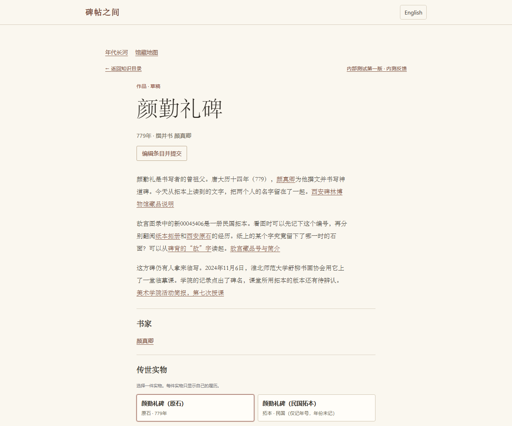

# Between Steles · 碑帖之间

**English** · [简体中文](README.md) · [Markdown library](knowledge/README.md) · [Chinese contribution guide](docs/CONTRIBUTE.zh-CN.md)

Which rubbing of the Yan Qinli Stele are we looking at when we copy it? Who was the text written for? What can still be made out of the 「故」 character on the back, depending on the version? Between Steles organises works, calligraphers and surviving witnesses from antiquity to the present, so a learner can follow one observation back to its documented source.

**[Open the website](https://yang963852.github.io/beitie-atlas/)** · [Read the Markdown library](knowledge/README.md) · [Download the full library (ZIP)](https://yang963852.github.io/beitie-atlas/download/beitie-knowledge.zip) · [Submit a source](https://github.com/yang963852/beitie-atlas/issues/new?template=knowledge.yml) · [Report beta feedback](https://github.com/yang963852/beitie-atlas/issues/new?template=beta-feedback.yml)



## What the site offers

- **Start at the desk.** An open sheet of paper leads into the chronology; the plate on the desk opens the object record of the Shenlong copy of the Lanting Preface.
- **Read a work.** Begin with the [Yan Qinli Stele](https://yang963852.github.io/beitie-atlas/#/work/yan-qinli-bei): background, calligrapher and surviving witnesses are kept apart, and the original stone and the Republican rubbing carry separate histories.
- **Follow the chronology.** Browse [every work](https://yang963852.github.io/beitie-atlas/#catalogue) by the period of the inscription, from the pre-Qin era to the present.
- **Use the collection map.** Locate witnesses by their present collection in the [collection map](https://yang963852.github.io/beitie-atlas/#/collections); places without reliable coordinates stay textual rather than guessed.
- **Search the library.** Enter the [library](https://yang963852.github.io/beitie-atlas/#/library) by work, calligrapher, reading note or object record — for example [Yan Zhenqing](https://yang963852.github.io/beitie-atlas/#/person/yan-zhenqing).

**Current corpus** (`npm run knowledge:compile`, 2026-11-25): 117 works · 126 physical objects · 46 places · 184 sources · 75 events. Some records are marked draft.

## Three editorial rules

- **Works and objects stay separate.** An original stone's excavation history is recorded once, in the stone's own record, never copied onto a rubbing or a recarving.
- **Conflicts stay visible.** Contradictory accounts are recorded side by side, each with its source, rather than resolved by picking the tidier claim.
- **Unknown stays unknown.** Years, coordinates and current teaching use without a source are left blank and marked as open questions.

See the [editorial workflow](docs/atlas-workflow.md) for research and review steps.

## How the library reaches the site

`knowledge/` Markdown author sources → read-only compiler → `data/index/knowledge-v1.json` → website, timeline, map and download package.

- `knowledge/` is the only author source, editable directly on GitHub or in Obsidian.
- The website never reads author Markdown, and the compiler never imports web code; `npm run check:isolation` enforces the boundary.
- Compiling the same input twice produces byte-identical output, verified by `npm run check:reproducible`.

More: [reconstruction plan](docs/knowledge-rebuild.md) · [architecture guide with five diagrams](docs/engineering-plan.md#负责人架构导读)

## Contribute

| Goal | Start |
| --- | --- |
| Fix an article or add a custody source | Edit the Markdown in a browser, or use the [knowledge form](https://github.com/yang963852/beitie-atlas/issues/new?template=knowledge.yml). Chinese only is fine |
| Edit one article in Obsidian | [Download the library ZIP](https://yang963852.github.io/beitie-atlas/download/beitie-knowledge.zip), then send a PR on the same path |
| Change the website or compiler | Fork, work on a branch and open a PR against `main`; read [setup and handoff](docs/START-HERE.md) first |
| Report a beta problem | [Beta feedback form](https://github.com/yang963852/beitie-atlas/issues/new?template=beta-feedback.yml) |
| Coordinate topics, review and merges | [Issues](https://github.com/yang963852/beitie-atlas/issues) · [Pull requests](https://github.com/yang963852/beitie-atlas/pulls) · [Milestone board](docs/iteration-board.md) |

Send a pull request directly; an Issue is optional, and Chinese explanations are welcome. [@yang963852](https://github.com/yang963852) is the primary reviewer and maintainer. [Contributing guide](CONTRIBUTING.md) · [Chinese guide](docs/CONTRIBUTE.zh-CN.md)

## Run locally

Node.js 24 (see [.nvmrc](.nvmrc)) and npm are required; on Windows PowerShell use `npm.cmd`.

```sh
git clone https://github.com/yang963852/beitie-atlas.git
cd beitie-atlas
npm ci
npm run dev
```

`npm run dev` compiles the library, generates the catalogue and packages the ZIP before starting Vite. Run `npm run check` before submitting: type, data, interface, isolation, reproducibility, documentation, tests and a preview build in one pass. The Tianditu basemap is optional; without a key the map falls back to a coordinate schematic — see [map setup](docs/map-setup.md).

## Repository layout

| Path | Contents |
| --- | --- |
| `knowledge/` | Author sources: works, objects, people, places, sources, reading notes |
| `scripts/` | Compiler, checks, library packaging and release gate |
| `src/` | React site: reading, chronology, map, library |
| `data/index/knowledge-v1.json` | Versioned interface produced by the compiler; the site reads only this |
| `docs/` | Architecture, editorial workflow, tasks and delivery records |

The retired corpus and milestones 001–039 are indexed in [the archive](docs/archive.md); local agent workspaces and handoffs are described in [the workflow](docs/agent-workflow.zh-CN.md) (Chinese).

## Status and limitations

- The site is the **first internal beta** on public GitHub Pages: drafts and open questions are visible and labelled. A formal edition requires the release gate and editorial approval — see the [release runbook](docs/release.md).
- The live basemap depends on the Tianditu network service; without a key, or when tiles are refused, the map shows a coordinate schematic. Observed access varies by network and must be tested locally; the project does not guarantee it.
- Quotations, collection images and map services retain their own terms. [License](LICENSE) · [Rights and attribution](NOTICE.md)

Original code, documentation and original editorial content are MIT-licensed.

## Contributors

[doublett523](https://github.com/doublett523) designed and implemented the writing-desk opening, ink-river chronology, collection map and library editing links. [Contribution #29](https://github.com/yang963852/beitie-atlas/pull/29)
