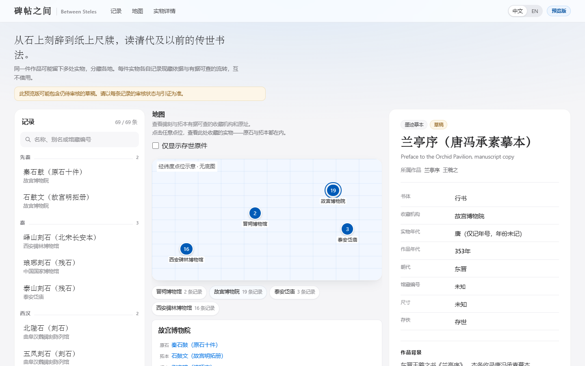

# Between Steles · 碑帖之间

[简体中文](README.md) · **English**

**[Open the online atlas](https://beitie-atlas.partedlute2.chatgpt.site/)** · [Report an issue or suggest a source](https://github.com/yang963852/beitie-atlas/issues)

A textual catalogue of Chinese calligraphic inscriptions, modelbooks and ink manuscripts through the Qing dynasty. Browse by period and inspect the date, holding, provenance and sources of each surviving witness.

The cutoff applies to the composition. Later rubbings and copies retain their own production dates. Each record carries its editorial status.



Task 024 local preview. Sites v7 is the public preview and v5 is the latest approved edition. [Versions and handoff](docs/START-HERE.md) · [Editorial review](docs/editorial-review-025.md)

## Run locally

Install Git and Node.js 24. Run these commands and open the address printed in the terminal.

```bash
git clone https://github.com/yang963852/beitie-atlas.git
cd beitie-atlas
npm ci
npm run dev
```

On Windows, `npm.cmd` also works. The corpus is readable without a map key. See the [Tianditu setup guide](docs/map-setup.md) to enable the basemap. Run `npm run check` before submitting changes.

## Stack and project documentation

React, TypeScript and Vite build the static app. JSON stores works, physical objects and sources. Tianditu supplies the basemap. Vitest and GitHub Actions run checks, and Codex Sites serves the public preview.

| Goal | Start here |
| --- | --- |
| Set up the project and find the right files or commands | [Maintainer and AI handoff](docs/START-HERE.md) · [Project rules](AGENTS.md) |
| Add a source, correct a holding, or submit code | [Contributing](CONTRIBUTING.md) · [Atlas workflow](docs/atlas-workflow.md) |
| Check progress and release criteria | [Iteration board](docs/iteration-board.md) · [Changelog](CHANGELOG.md) · [Release runbook](docs/release.md) |

Original code, documentation and editorial contributions are available under the [MIT License](LICENSE). Third-party material and map services carry their own terms. [Rights and acknowledgements](NOTICE.md)
