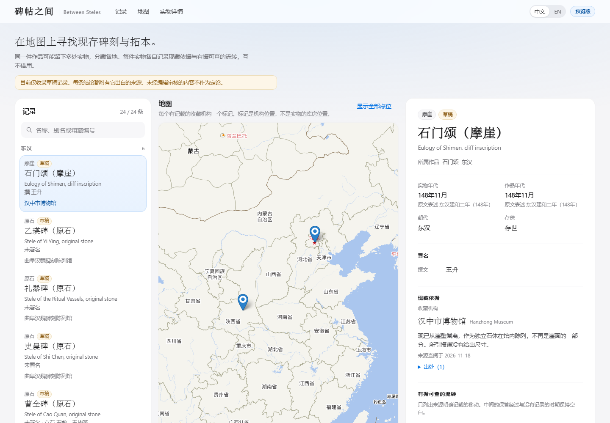

# 碑帖之间 · Between Steles

[Project website on Codex Sites](https://beitie-atlas.partedlute2.chatgpt.site/)

**English** | [简体中文](README.zh-CN.md)

**Initial collaborative source: v0.1.0-alpha.1.** Start with the
[maintainer/AI handoff](docs/START-HERE.md) to understand and modify the project
without the original conversation. [Changelog](CHANGELOG.md) · [License](LICENSE) · [Rights](NOTICE.md).

## Current development guidance

Before implementation read [agent rules](AGENTS.md), [contribution workflow](CONTRIBUTING.md),
[design system](docs/design-system.md), and [iteration board](docs/iteration-board.md).
Task 001 passed local checks but required changes; see [review](docs/review-001.md).
Task 002 passed independent local review; see [review 002](docs/review-002.md)
and [delivery 002](docs/delivery-002.md). Task 003 replaced the foundation screen with the
neutral map-led interface ([delivery 003](docs/delivery-003.md)). Task 007 adds the
Chinese-first interface, the blue visual pass, and a twelve-object corpus
([delivery 007](docs/delivery-007.md)). Task 008 doubles the corpus with steles whose
original stone survives and with two works known only through a single rubbing
([delivery 008](docs/delivery-008.md)). Task 009 files every work under a period and records
who is credited, including the steles that name nobody ([delivery 009](docs/delivery-009.md)).
Tasks 007 to 009 await independent review. The next
implementation task is the [real map pilot](docs/map-pilot.md).
The [initial snapshot's CI checks passed on GitHub](https://github.com/yang963852/beitie-atlas/actions/runs/44102927813). CI validates previews and does not deploy.

An open-source atlas of Chinese calligraphic inscriptions and selected rubbings: what survives, where it is documented today, and how its history connects places.

**Preview status, 2026-11-18.** The corpus contains 33 works, 36 physical objects, 15 places and 54 sources. Four mapped locations account for 22 objects. The interactive coordinate overview works without a key. Local Tianditu rendering has been verified with a browser key. Mainland public-network access and independent editorial review remain pending.

The Chinese project name is final. `Between Steles` is a working English title. The public repository is [yang963852/beitie-atlas](https://github.com/yang963852/beitie-atlas).

## Interface



Captured from the local preview with an owner-supplied Tianditu browser key on 2026-11-18: the
base map fills the column, the two institutions with documented coordinates carry markers, and
the list stays grouped by period with the credited hands. The key lives in `.env.local` and is
not committed. Mainland public-network and mobile-network behaviour are still unverified; see
[delivery 004](docs/delivery-004.md).

## Confirmed direction

- Start with stone inscriptions and a small number of individually identified rubbings.
- Prioritize readers in mainland China while supporting an international audience.
- Use English for implementation and documentation. The interface opens in Chinese with an English switch (owner direction, 2026-11-18). Preserve Chinese original titles, aliases, inscriptions, and source references.
- The owner sets priorities. Codex designs and reviews. DeepSeek in WorkBuddy implements bounded tasks.
- Browse records by the period of the represented inscription. A rubbing and a recarving retain their own production dates and holdings.

## Start here

- [可行性与协作方案](docs/可行性与协作方案.md): the owner's Chinese guide.
- [Engineering plan](docs/engineering-plan.md): scope, data model, architecture, and acceptance gates.
- [Source audit](docs/source-audit.md): researched sources, supported claims, and known gaps.
- [WorkBuddy task 001](tasks/001-foundation.md): first implementation brief, ready to copy into WorkBuddy.
- [Map pilot](docs/map-pilot.md): provider evaluation, coordinate treatment, credential model, and the remaining test plan.
- [Map setup for the owner](docs/map-setup.md): the beginner-facing steps to enable the map (Chinese).
- [Release runbook](docs/release.md): the only permitted publishing command and the artifact it must produce.
- [Atlas workflow](docs/atlas-workflow.md): source evidence, GitHub and Codex Sites publication.
- [Delivery report 001](docs/delivery-001.md): what was built, how it was checked, and what is still open.
- [Delivery report 002](docs/delivery-002.md): review fixes, the strict release gate, and what remains unverified.
- [Delivery report 003](docs/delivery-003.md): the map-led redesign, mobile flow, and the checks still pending.
- [Delivery report 007](docs/delivery-007.md): Chinese-first copy, the blue visual pass, the expanded corpus, and what stays unverified.
- [Delivery report 008](docs/delivery-008.md): twelve extant steles and two rubbing-only works, the conflicting-source policy, and why the map did not grow.
- [Delivery report 009](docs/delivery-009.md): period ordering, the eight attribution roles, and the five steles that now say “unrecorded”.
- [Map options](docs/map-options.md): six basemaps compared on keys, datum, compliance and cost, and why coordinate evidence is the real blocker.
- [Delivery report template](templates/delivery-report.md): the evidence required for review.

## Essential distinctions

A **work** is a named inscription or calligraphic composition. An **object** is a particular stone, rubbing, copy, or fragment. Locations and provenance belong to objects, not indiscriminately to a work title.

“Current location” means a source-supported collection or in-situ location, with a source access date. It does not mean live tracking, a verified storage room, or a guarantee that the object is on public display.

## Development and publication

The core is React 19, TypeScript, Vite 7, npm, and reviewed local JSON records. Node 22.22.2
was used for the recorded checks; `package.json` requires `>=22.12.0`. No runtime backend,
accounts, write API, or runtime AI generation is involved.

```bash
npm ci               # reproducible install from the committed lockfile
npm run dev          # development server (prints its own address)
npm run check        # type check + data validation + tests + preview build
npm run build        # type check + preview build into dist/ — never publish this
npm run preview      # serve the built site locally
npm run release      # the only publishable build; fails on draft/invalid data
npm run check:release # strict data gate only, no build
```

`npm run release` deletes any previous `dist/` first, refuses to build while records are drafts,
and writes a `release` marker plus `dist/release-manifest.json`. A failure leaves no artifact
that could be uploaded by mistake. See [docs/release.md](docs/release.md).

The map is optional and needs a public Tianditu browser key at build time. Without one the
site shows an explanatory panel and remains fully readable. A browser key is public after
building; `.env` cannot hide it. Owner steps are in [docs/map-setup.md](docs/map-setup.md).
GitHub source hosting and public website hosting are separate decisions, and the map provider
plus host must pass a mainland-network pilot before they are finalized. Mainland public access
has not been tested.

## Open-source direction

Original code, documentation and original editorial contributions are available under [MIT](LICENSE). Third-party material is excluded; read [NOTICE.md](NOTICE.md). Public source availability is separate from editorial approval of a production website. All current work/object records remain drafts.

Inspired by [jiangshan-map](https://github.com/DeanChensj/jiangshan-map). That repository uses [GPL-3.0](https://github.com/DeanChensj/jiangshan-map/blob/main/LICENSE). This project currently references its interaction ideas and does not include copied source code, maps, or artwork.
