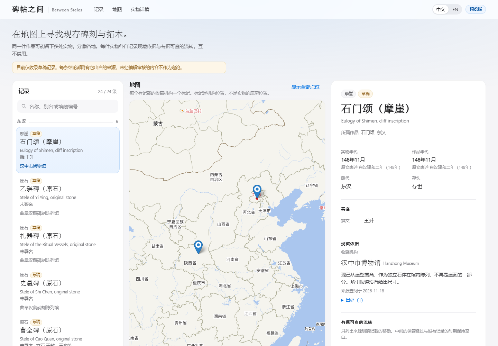

# 碑帖之间 · Between Steles

[三栏图鉴预览 · Codex Sites](https://beitie-atlas.partedlute2.chatgpt.site/)

[English](README.md) | **简体中文**

在地图上寻找现存碑刻与拓本，了解它们叫什么、怎么形成、现在由哪里收藏，以及有据可查的流转历史。

**当前版本：v0.1.0-alpha.1，初始协作开发版。** 源码已公开，欢迎共同完善；尚未上线正式网站。资料仍为草稿，真实底图已在本地验证，大陆公网与移动网络尚未验证。



截图为 2026-11-18 用业主提供的天地图浏览器密钥在本地预览实拍：底图铺满地图栏，两处有坐标的机构显示标记，左侧仍按朝代分组、每行标出撰书刻者。密钥保存在 `.env.local`，不进入仓库。详情见[第四轮交付报告](docs/delivery-004.md)。

[项目仓库](https://github.com/yang963852/beitie-atlas) · [版本记录](CHANGELOG.md) · [问题反馈](https://github.com/yang963852/beitie-atlas/issues) · [MIT 许可证](LICENSE)

## 从这里开始

如果你第一次接触这个项目，或者希望交给另一个 AI 接手，请先阅读：

- [维护者与 AI 交接说明](docs/START-HERE.md)：运行方法、文件结构、修改入口、已知限制。
- [项目规则](AGENTS.md)：所有参与者遵循的数据和开发约束。
- [协作指南](CONTRIBUTING.md)：如何提出修改、提交代码与验收。
- [迭代看板](docs/iteration-board.md)：当前进度与下一步。
- [可行性与协作方案](docs/可行性与协作方案.md)：项目的中文背景说明。

无需阅读原始聊天，也不要求使用某个特定 AI 工具。

## 项目想解决什么

同一部书法作品可能有原碑、翻刻、不同年代的拓本等多个实物，它们并不在同一个地方。

本项目把“作品”和“具体实物”分开记录。地图上的地点属于具体实物，其历史事件各有出处。馆藏机构不等于今天的展厅；网页核查日期也不等于文物当天的位置确认。查不到的历史保留空白，不自动补成完整故事。

第一阶段以碑刻为主，加入少量拓本；优先考虑中国大陆读者，同时兼顾海外。界面默认中文，可切换英文；中文原名、别名和原始资料一律保留原文。

## 当前已经具备

- 中文名、英文名、别名和馆藏编号搜索；界面默认中文，右上角可切换 English。
- 搜索结果与地图地点列表联动。
- 实物详情、现藏信息、历史时间线和来源链接。
- 实物分享链接与页面内导航。
- 未配置地图时仍可阅读资料的降级界面。
- 数据校验、96 项自动测试、正式发布前的严格检查。
- 地图密钥可用 `npm run check:map-key` 一条命令自检：只发一次地名搜索请求，不打印完整密钥，并把「密钥无效」「Key 类型或来源不匹配」「配额用尽」分开报出来。
- 列表按朝代分组、组内按刻立年排序；每行列出席名者，详情页分行列出撰文、书丹、刻字、篆额、立石。

当前收录 **33 部作品、36 件实物、15 处地点、54 条来源**。左栏从秦排到民国，共 12 个朝代或时期。峄山刻石列在秦代，详情标明现存石刻是北宋长安本。张猛龙碑原石与明拓本各有独立详情和收藏依据。

中间地图可点开 **4 处收藏地点、22 件实物**。天地图底图可用本机浏览器密钥启用，无密钥时仍可在经纬度示意上打开点位。其余 14 件保留可查的现藏资料和出处，列入「暂无地图点位」。数据仍待编辑审核，大陆公网尚未实测。维护与部署步骤见[项目工作流](docs/atlas-workflow.md)。

## 在自己电脑上运行

准备 Node.js 24 和 Git，然后执行：

```bash
git clone https://github.com/yang963852/beitie-atlas.git
cd beitie-atlas
npm ci
npm run dev
```

打开终端显示的本地地址。Windows PowerShell 中如果 `npm` 脚本执行受限，可以使用 `npm.cmd`，无需修改系统执行策略。

不配置地图密钥也可以运行。需要开启地图时，按[地图配置说明](docs/map-setup.md)操作。浏览器密钥会随网页公开，应按服务商要求限制域名和额度。

| 命令 | 用途 |
| --- | --- |
| `npm run check` | 类型、资料、测试及预览打包检查 |
| `npm run build` | 生成本地预览版本 |
| `npm run preview` | 在本机查看已打包的预览 |
| `npm run check:release` | 检查资料能否正式发布，不修改输出目录 |
| `npm run release` | 严格检查通过后才生成正式网站文件 |

**目前正式发布检查应当失败**，因为三条作品/实物记录仍是草稿。不要为了让检查通过而把未经审核的资料标为已审核。源码开源与历史资料正式发布是两件事。详情见[发布说明](docs/release.md)。

## 如何一起完善

你可以在 Issues 中反馈问题、提供资料或提出功能建议，也可以 Fork 仓库，在自己的分支修改后提交 Pull Request。无需先获得直接写入权限。

- 修正资料：附上官方链接或书名、版本、页码，说明证据能支持什么。
- 新增实物：区分原碑、翻刻、拓本和残片，保留缺失与争议信息。
- 修改代码：先阅读项目规则，每轮处理一个明确目标，附上检查结果。
- 提供图片：说明作者、来源与使用许可；网页能看到不等于可以再分发。

项目已经准备了问题反馈模板、资料纠错模板和 Pull Request 模板。请勿提交密钥、密码或无关个人文件。

## 验收与下一步

第二轮修复已通过独立本地检查；[初始版 GitHub 自动检查通过](https://github.com/yang963852/beitie-atlas/actions/runs/44102927813)。参见[第二轮审查记录](docs/review-002.md)。

第三轮界面改进已交付，参见[第三轮交付报告](docs/delivery-003.md)。第七轮已交付中文化、蓝色视觉与语料扩充（详见[第七轮交付报告](docs/delivery-007.md)）。第八轮把语料扩到 24 件实物，以原石尚存者为主，并收入两件只存拓本的作品，详见[第八轮交付报告](docs/delivery-008.md)。第九轮补上朝代字段与作者信息（83 项测试通过），并把地图的六种方案、合规要求与点位缺口写成[地图方案对比](docs/map-options.md)，详见[第九轮交付报告](docs/delivery-009.md)。第十轮补上密钥自检命令，并把[天地图开通手册](docs/map-setup.md)改写成逐步可执行的版本（当时 94 项测试通过）。任务 004 随后用业主提供的密钥完成真实底图验证：1440 与 390 两个宽度都能出图，96 项测试通过，详见[第四轮交付报告](docs/delivery-004.md)。下一步依次是：大陆公网与移动网络验证、补齐馆藏坐标、首批公开资料与正式网站发布。每轮均有任务单、交付报告和独立验收，具体见迭代看板。

## 许可与致谢

项目原创代码、文档及原创资料整理贡献采用 [MIT](LICENSE) 许可。第三方引用、馆藏图片、地图服务和依赖保留各自权利，详见[权利说明](NOTICE.md)。

交互灵感来自 [江山时序 / jiangshan-map](https://github.com/DeanChensj/jiangshan-map)。当前项目独立实现，未有意引入其代码或素材；今后若复用，须遵守原项目 GPL-3.0 等适用许可。
