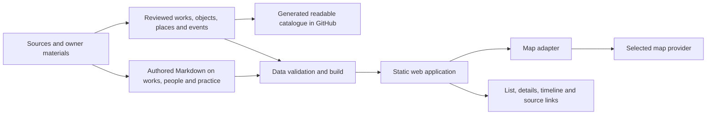

# Engineering plan

The catalogue covers calligraphic inscriptions, modelbooks, manuscript copies and ink manuscripts from antiquity to the present. Prioritize representative works, documented hands and models with evidence for practice or teaching use. Each physical witness keeps its own production date. The first internal beta pairs Yan Zhenqing and Shen Yinmo as historical and modern entry points.

## Product contract

The catalogue serves people learning calligraphy by copying historical models. It connects each model to a surviving stone, impression, manuscript or copy, its documented holding and its transmission. Research begins with named hands, then follows institutional catalogues to identifiable witnesses. Work.studyCategory files inscriptions as bei and manuscript traditions or engraved modelbooks as tie. Every physical witness inherits its work’s filing, including rubbings.

Visitors can identify a surviving physical object, find its documented collection or in-situ location, read its creation and provenance history, and inspect the evidence. The site does not promise exhaustive coverage, live location, or present-day exhibition availability.

The text record leads with identity, date, script and documented holding. Physical dimensions and catalogue numbers remain unknown until an institution or consulted catalogue supports them.

## Architecture



- Use React + TypeScript + Vite, npm, a committed lockfile, and a documented supported Node version.
- Keep structured catalogue facts in versioned JSON and original editorial prose in the [Markdown knowledge library](../knowledge/README.md). Build the static site from both. Generated catalogue pages and indexes are readable on GitHub and checked for drift. Ingestion travels through GitHub Issues and PRs.
- Place provider integration behind a small map component boundary: points, selection, focus, and optional schematic event connections. Do not design a generic GIS framework.
- M0 first evaluates the official Tianditu integration and its current account conditions. AMap is the fallback candidate. Leaflet stable is suitable if the selected licensed tile integration supports it; do not assume that changing a tile URL makes every provider interchangeable.
- Pin tested stable versions. The Leaflet documentation homepage currently describes a beta; explicitly use stable documentation if selecting Leaflet.
- Keep matching interface dictionaries in `src/i18n/en.ts` and `src/i18n/zh.ts`. Preserve Chinese titles, aliases and authored Chinese prose. Show the source language where a translation is missing.
- Use ordinary React state initially. Avoid premature state frameworks, CMSs, microservices, and search servers.
- Preserve canonical records independently of map vendors. A credential proxy, if required by the selected provider, is a separately documented deployment component, not an unnoticed expansion into a full backend.

Implementation layout:

```text
src/components/       map, results, detail, timeline, source citation
src/domain/           types, validation, search, temporal helpers
src/map/              one selected provider adapter and configuration
src/i18n/             interface dictionaries
knowledge/            authored Markdown and readable generated catalogue
data/works/           composition-level records
data/objects/         physical objects and embedded provenance events
data/places.json      reusable place records
data/sources.json     bibliography and web references
data/media.json       only approved reusable assets
tests/fixtures/       clearly synthetic edge cases, excluded from release data
docs/                 requirements, decisions, review reports
```

## Data model and invariants

| Entity | Minimum meaning and fields |
| --- | --- |
| Work | Stable ASCII `id`; Chinese and English titles; aliases; author roles and uncertainty; composition date; script; sourced background. |
| Object | Stable `id`; `workId`; object type; object-specific title; creation date; catalog number when available; survival status; relationships; current collection assertion; provenance events. |
| Place | Stable `id`; Chinese and English names; historical name where relevant; kind; coordinates or null; coordinate system; precision; evidence or geocoding method. |
| Event | Stable `id`; object association; type; date/range; place or null; original place wording; concise original summary; evidence links; certainty. |
| Source | Stable `id`; title; author/publisher; URL or bibliography; publication date when available; access date; relevant page/section. |
| Media | Asset path or approved URL; depicted object; creator; source; license and version; credit; rights evidence; acquisition date. |

Avoid a full scholarly ontology in v0.1. Events can live inside their object files. Use cross-file IDs only where they solve actual duplication.

Identity rules:

1. One work can have many objects; one marker represents a physical object or an explicitly labeled collection of objects.
2. Separate `original-stele`, `cliff-inscription`, `recarving`, `rubbing`, and `fragment`. Store relations such as `rubbing-of`, `recarving-of`, or `fragment-of`, with supporting references.
3. Creation of the composition, carving of the stone, production of a rubbing, excavation, and accession are different events. A Tang inscription does not make a Republican-era rubbing a Tang physical object.
4. Do not inherit the original stone's movements into a rubbing's provenance. Do not infer location from a collector's birthplace, office, seal, or colophon without an explicit argument and evidence.
5. Physical survival, evidence certainty, and editorial review state are separate. A lost original may have surviving derivatives; a draft record must not silently appear as reviewed.

Current collection assertion:

- Distinguish collection institution from documented physical location, temporary loan location, and display status.
- Store `locationKind` (collection institution / in situ / last known / unknown), `placeId` or null, `sourceRefs`, `sourceAccessedAt`, and `assertionAsOf` if the source provides a temporal anchor.
- Accessing an old source today does not update its assertion date. UI wording: “Documented collection” or “Location reported by source”, with a link and checked date.
- Mark coordinates for a collection institution as an institution marker, not the precise storage location of the object. Do not derive a branch, exhibition hall, or vault from a museum's general address.
- Unknown and last-known locations remain in the list. Last-known places are not presented as verified current markers.

Dates and uncertainty:

- Support year, bounded interval, approximate date, unknown, and disputed claims. Preserve original era/date wording.
- Use signed integer years when needed, with a documented no-year-zero convention; avoid JavaScript Date for historical sorting.
- Open interval endpoints are null; null means unknown/unbounded, not the year zero or today. A single known year is not an exact day.
- Each historical claim cites its own source and locator. Use explicit certainty labels such as documented / approximate / disputed / unknown rather than invented numerical confidence.
- Preserve conflicting accounts as separate sourced claims with an editorial note. Do not merge them into one precise fictional history.

Geography:

- The normalized geographic layer targets WGS84. Store explicit `longitude` and `latitude` names, origin CRS, coordinate source, and transformation provenance when applicable.
- Do not relabel GCJ-02, BD-09, CGCS2000, or an unknown CRS as WGS84. If no defensible conversion is available, preserve the source coordinates separately and withhold the canonical point.
- GeoJSON uses longitude then latitude. Leaflet interfaces commonly use latitude then longitude; convert at the adapter boundary.
- Precision is one of site / institution / city / region / unknown. A centroid is a representative point and must be labeled as such; do not invent a numerical accuracy radius.
- Historical toponyms need manual resolution and uncertainty labels. A modern geocoder alone does not establish a historical location.
- Default to a modern basemap. Do not add historical territorial polygons in v0.1.
- Known event places may be connected schematically, with a visible explanation. Unknown intervals remain gaps; never invent roads, transfer dates, or intermediate stops.

## UI behavior

- Desktop: search/results, map, and an object detail panel. Mobile: usable list and detail views plus map access; avoid squeezing three columns onto a phone.
- Display Chinese original title near the English title, object type, collection label, and provenance sources.
- Search English titles, Chinese titles, and aliases. Simplified/traditional aliases should be explicit where useful, not invented by a lossy title replacement.
- Distinguish “work period” from “object production period” in filters.
- Combine objects at the same institution into an expandable marker/list. Keep counts and filters consistent across map and list.
- Store selected object ID in a query or hash link; avoid history-routing paths that need unsupported host rewrites.
- A basemap error must not hide the corpus. Show an accessible error and keep the list, details, and source links functional.
- Make selection possible by keyboard and from the list. Color alone must not communicate certainty. Respect reduced motion and avoid heavy external font requirements.

## Data workflow

Candidate → source collection → draft → fact and rights review → approved → build checks → publication.

Record sources before writing the narrative. Summarize facts in original prose. AI output is a drafting aid, not evidence. Do not scrape or redistribute an entire museum catalog as a shortcut.

Readers can submit a single source or lead in Chinese using the knowledge Issue form. An editor checks the evidence, normalizes accepted fields, links the original Issue and preserves credit. Members may edit authored Markdown directly in a GitHub browser or local checkout. Source gaps stay visible.

For v0.1, review all publication records, not a random sample. Keep a future maintenance queue for stale links, collection changes, disputed claims, and image permissions. An update to collection data changes its review record, not unrelated dates.

## Release gates

Automated checks must catch meaningful risks:

- Duplicate IDs, missing references, missing evidence for published collection assertions and dated events.
- Invalid coordinate ranges/CRS, missing precision metadata, null converted to zero, and latitude/longitude inversion fixtures.
- Invalid date intervals; unknown and approximate dates must remain representable.
- Unreviewed entries and synthetic fixtures leaking into publication data.
- Bundled images without rights records; broken internal paths; unsafe URL protocols.
- Type check and production build; representative interaction checks for selection, search, filtering, history gaps, same-site objects, and direct-link refresh.

Do not build a giant test suite for cosmetic choices. Check the actual risks and a small end-to-end journey.

Manual acceptance:

1. Open the same tested build on mainland desktop broadband and mobile data without special network routing. Record date, network, browser, page loading, and map loading separately.
2. Check an overseas connection if available; otherwise label overseas verification outstanding.
3. Select the Yan Qinli original stone and the Palace Museum rubbing. They must have independent IDs, collection assertions, and histories.
4. Open an unknown-location record and a record with historical gaps; no false precise map point or continuous fictional journey appears.
5. Follow source links for each seed object's current collection and key events.
6. Refresh a share link under the deployment's actual base path. Verify mobile layout and keyboard access.
7. Disable/block the map provider: list and detail content remain usable.

M0/M1 local code checks can pass before external access checks. Report these as separate statuses; do not declare the mainland deployment gate passed from a local preview.

## Hosting, rights, and credentials

- GitHub is the public source host. Never publish the parent workspace; it contains unrelated personal material.
- GitHub Pages is the sole website host and serves the interactive draft preview. Verify mainland access separately.
- Vite's base URL must match the deployment path. The Pages workflow reads the project base path from `actions/configure-pages`.
- Browser-embedded configuration is public even when injected from a build environment. `.env` alone cannot hide a frontend secret. Use provider-supported domain restrictions, quotas, and a server-side proxy if required; document added costs.
- Preserve provider attribution and any required approval number. Do not use undocumented tile endpoints or remove official map annotations. Provider terms and host requirements must be checked for the selected release setup.
- Original code: MIT recommended. Editorial data: separate license only for material the project can license. Third-party media: per-item rights. Placeholders or links are acceptable when image reuse is not established.
- `jiangshan-map` uses GPL-3.0. Any later source reuse must be reviewed before selecting the resulting application license. Do not assume museum images inherit the code license.

## Collaboration

The coordinator chooses priorities, resolves editorial or technical disagreements, names reviewers and decides merges, or explicitly delegates a specific merge. Members choose their local tools. Assign one lead per bounded task and coordinate overlapping files. Independent tasks can proceed concurrently.

Use one small PR per bounded change. Routine handoff lives in the Issue and PR, with changed subjects or files, actual command outcomes, unresolved questions and the revision tested. Milestones, migrations and releases also retain the numbered task, board row and delivery report. Identify self-review and the owner of the final decision.

Reviewer findings should include severity, file/location, reproduction, expected behavior, and a proposed fix direction. Fix findings on the same task before expanding scope. Update a short decision log when a reviewed architecture choice changes.

## Why this stack, and what it can still absorb

**Markdown decision (task 036).** One authored Chinese article must be readable and editable on GitHub and render in the React website. Use `react-markdown` to render basic CommonMark paragraphs, headings, lists and links as React elements. Authors can preview this shared subset on GitHub. Keep raw HTML execution disabled. Use standard links for citations and formatting that renders in both readers. A claim requiring an image or extended GitHub-only syntax needs review on both surfaces. This keeps editorial content out of UI strings and supports a static build.

Use the `yaml` development dependency to parse frontmatter at build time with duplicate-key detection. The catalogue generator, validator and Vite integration share that parser, so a contributor editing a title or list of references gets the same result locally and on CI.

Asked plainly: the site is written in JavaScript. TypeScript is JavaScript with types that are erased at build time, React is a component library, Vite is the bundler, and npm installs the packages. There is no other language in the built artifact.

Three properties decided the shape, not fashion:

- **The corpus is files in Git, edited by people and reviewed before publication.** Members submit changes to the repository through Issues or PRs. The published site has no account or write API.
- **Everything is static.** The build turns catalogue data and library Markdown into static assets, including the reader UI. Map service availability is independent of reading the catalogue.
- **The interface is stateful in one place.** Search filters the list, the place panel and the detail at once; the map has to survive that filtering; a permalink has to survive a refresh. That is why React earns its place here: hand-written DOM code would spread the same state across event handlers and focus management, which is where the bugs in this project actually came from.

**Why not plain HTML and JavaScript.** Possible, and smaller on paper. It becomes expensive exactly where this product is unusual: filtering three views from one query, keeping markers in step with a filtered list, moving focus between mobile panes, and restoring a record from a URL fragment. Those are all implemented once, in React, today.

**Why not a framework with a server (Next.js and similar).** The project needs rendering, not a server. Server rendering would add a runtime, a deploy target and a second data path to solve a problem the corpus does not have. If indexing each record by search engines becomes a requirement, a static prerender step is the cheaper answer, and it does not change the data or the components.

**What happens as the corpus grows.**

| Growth | What changes | What stays |
| --- | --- | --- |
| A growing catalogue | Measure compiled asset size and loading time for both knowledge and witness views | Stable IDs, evidence and reader journeys |
| If the bundled corpus becomes expensive to load | Split the data at the domain boundary into separately loaded chunks, then verify both browser and CLI paths | Public routes and validation rules |
| A different map provider | Implement `MapAdapter` in `src/map/types.ts`: mount, focus, fit, destroy | Markers, filtering, detail view, evidence rules |
| A third language | Add a dictionary in `src/i18n/` and register it | Components, data, validation |
| Photographs or IIIF images | `data/media.json` already models rights, credit and licence; a media pipeline and hosting do not exist yet | Records, map, list |
| Published book sources | Supported since task 018: publisher, year, page locator, no URL | Everything |

**What would force a real rewrite.** Only two things: personalisation that must be computed per reader, or real-time collaborative editing. Neither is on the roadmap, and neither can be added by accident, because both require a backend that the current build deliberately does not have.

## Primary technical references

- [Vite static deployment](https://vite.dev/guide/static-deploy)
- [Leaflet stable documentation](https://leafletjs.com/reference-1.9.4.html)
- [OSM tile policy](https://operations.osmfoundation.org/policies/tiles/)
- [GeoJSON RFC 7946](https://www.rfc-editor.org/rfc/rfc7946.html)
- [Tianditu official regional access guide](https://tianjin.tianditu.gov.cn/static/help/note.html) — recheck the chosen national/regional service's actual terms.
- [AMap security guidance](https://lbs.amap.com/api/javascript-api-v2/guide/abc/jscode)
- [AMap loading requirements](https://lbs.amap.com/api/javascript-api-v2/guide/abc/load)
- [AMap coordinate conversion](https://lbs.amap.com/api/javascript-api-v2/guide/transform/convertfrom)
