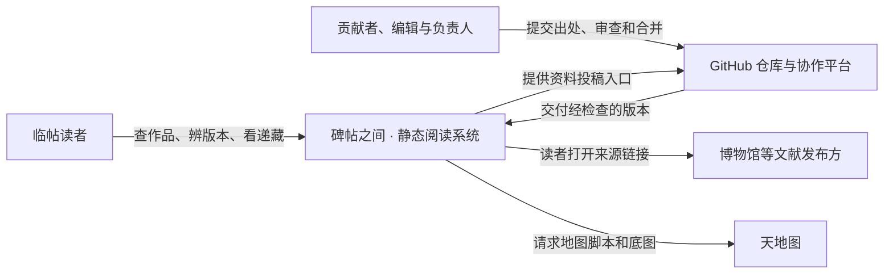
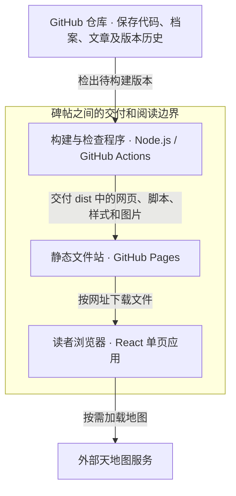
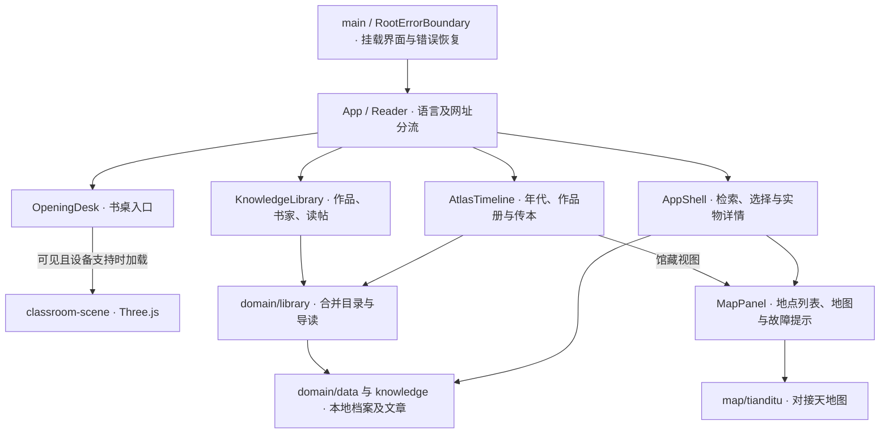
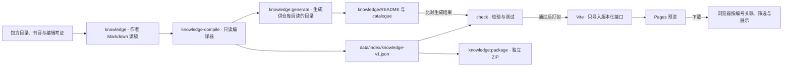
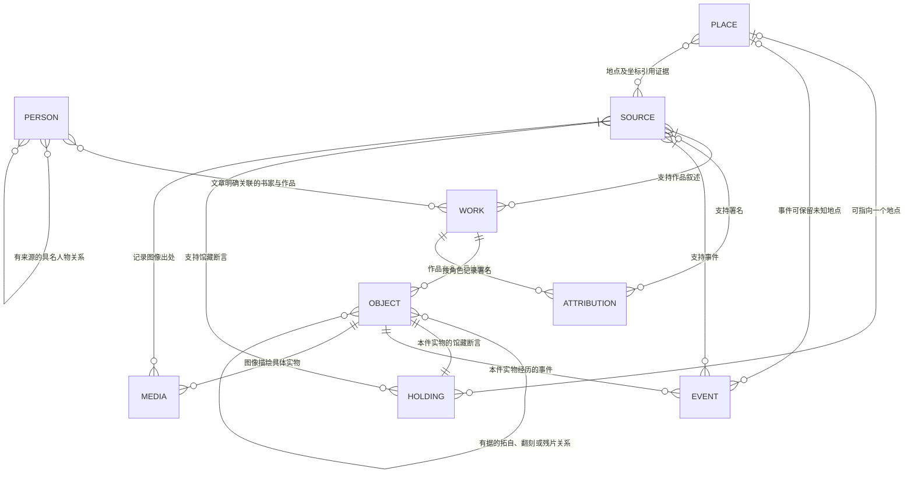

# Engineering plan

The catalogue covers calligraphic inscriptions, modelbooks, manuscript copies and ink manuscripts from antiquity to the present. Prioritize representative works, documented hands and models with evidence for practice or teaching use. Each physical witness keeps its own production date. The first internal beta pairs Yan Zhenqing and Shen Yinmo as historical and modern entry points.

## Product contract

The catalogue serves people learning calligraphy by copying historical models. It connects each model to a surviving stone, impression, manuscript or copy, its documented holding and its transmission. Research begins with named hands, then follows institutional catalogues to identifiable witnesses. Work.studyCategory files inscriptions as bei and manuscript traditions or engraved modelbooks as tie. Every physical witness inherits its work’s filing, including rubbings.

Visitors can identify a surviving physical object, find its documented collection or in-situ location, read its creation and provenance history, and inspect the evidence. The site does not promise exhaustive coverage, live location, or present-day exhibition availability.

The text record leads with identity, date, script and documented holding. Physical dimensions and catalogue numbers remain unknown until an institution or consulted catalogue supports them.

## 负责人架构导读

**代码基线为 2026-11-24 核对的主分支 `c6fd7c0`。** 以《颜勤礼碑》为例，编辑把“这是一部什么作品”写进作品档案，把“故宫著录的是哪一件拓本”写进实物档案，把“临写时看什么”写成文章。构建工具把三者编成网站，读者点开时，由浏览器按编号找出对应内容。改一条馆藏记录，要改仓库里的源文件，经过审阅、合并、重新构建，读者才会读到新版。

以下前三幅图按 C4 模型由远及近观察同一个系统。第一层看谁与网站往来，第二层看程序在哪里运行，第三层打开浏览器程序看内部分工。这里的“容器”指能单独运行或部署的单元，无需安装 Docker。箭头上的文字说明双方实际交换什么。第四幅图另按时间顺序读，第五幅图解释档案之间的关系。

### 1 · 谁使用系统（C4 系统上下文，已实现）



网站可以引用纸本目录的出版社、年份和页码。读者点开馆方网页是在查证来源，馆方网站无需参与每次目录查询。读者投稿、编辑修改和负责人合并都在 GitHub 的协作流程中完成。

### 2 · 程序运行在哪里（C4 容器，已实现）



**开发与部署。** TypeScript 给数据和函数标明类型，帮助编辑代码时发现用错字段；React 把界面拆成可更新的部件；Vite 把代码、样式和资料打包成浏览器可读文件。Node.js 运行构建脚本，CI（提交后自动执行的检查）按 `.nvmrc` 使用 Node 24，npm 按锁文件还原依赖。Vitest、jsdom 和 Testing Library 在模拟浏览器环境中检查交互。Three.js 负责开场的立体书桌，react-markdown 把作者写的 Markdown 排成网页。[依赖与命令](../package.json) · [构建配置](../vite.config.ts)

**从合并到可访问。** PR 是请他人审阅并合入一组改动的申请。PR 检查运行 `npm run check`；主分支的 Pages 流程再用实际站点子路径检查，用构建环境提供的浏览器地图键重建，确认 HTML 带有 preview 标记，再上传、部署。GitHub Pages 是唯一网站主机。键一旦进入浏览器就可见。正式出版另走严格资料检查、构建、核验发布清单、编辑批准和主机核查。当前自动流程部署带标识的预览。工作流能说明部署机制，中国大陆实际访问和当天的地图服务状态需另测。[PR 检查](../.github/workflows/check.yml) · [Pages 工作流](../.github/workflows/pages.yml) · [正式发布手册](release.md)

### 3 · 打开页面以后（C4 浏览器核心组件，已实现）



网址中 `#` 后的部分是浏览器的页内地址。例如 `#/work/yan-qinli-bei` 打开知识条目，`#/object/dpm-rubbing-xin00045406` 打开实物详情。刷新时主机仍返回同一个入口网页。读者切换馆藏、搜索、选择记录时，React 在本机保存当前界面状态。中英界面词在 `src/i18n/`；历史材料保留所录语言。开场支持减少动态效果和直接进入目录。地图脚本或底图小块（瓦片）加载失败时仍可读地点和实物记录。[入口分流](../src/App.tsx) · [知识目录](../src/domain/library.ts) · [开场](../src/components/OpeningDesk.tsx) · [地图面板](../src/components/MapPanel.tsx)

### 4 · 一次资料改动怎样到达读者（数据流，已实现）



- Use React + TypeScript + Vite, npm, a committed lockfile, and a documented supported Node version.
- Keep structured facts and original editorial prose in the [Markdown knowledge library](../knowledge/README.md); `scripts/lib/knowledge-compiler.ts` compiles the author source into the versioned `data/index/knowledge-v1.json` interface. Build the static site, checks, timeline, map and download package from that interface only. Generated catalogue pages and indexes are readable on GitHub and checked for drift. Ingestion travels through GitHub Issues and PRs.
- The pre-rebuild JSON corpus and its one-time migration tools were retired on 2026-11-25. They remain in the annotated tag `archive-pre-hygiene-2026-11-25`; do not reintroduce them into `main` or import them from `src/`.
- Place provider integration behind a small map component boundary: points, selection, focus, and optional schematic event connections. Do not design a generic GIS framework.
- Tianditu is the implemented live provider. The local location overview remains available when the key, SDK or tiles are unavailable. See [the adapter](../src/map/tianditu.ts) and [the earlier provider evaluation](https://github.com/yang963852/beitie-atlas/blob/archive-pre-hygiene-2026-11-25/docs/map-options.md).
- Keep matching interface dictionaries in `src/i18n/en.ts` and `src/i18n/zh.ts`. Preserve Chinese titles, aliases and authored Chinese prose. Show the source language where a translation is missing.
- Use ordinary React state initially. Avoid premature state frameworks, CMSs, microservices, and search servers.
- Preserve canonical records independently of map vendors. A credential proxy, if required by the selected provider, is a separately documented deployment component, not an unnoticed expansion into a full backend.

**给 Agent 分配文件。** 改作品、实物、人物、地点、来源或事件，从 `knowledge/` 找对应 Markdown；改读帖文章，也从 `knowledge/notes/`；改判断“哪些地点能画成当前藏点”的规则，看 `src/domain/collection.ts`；改地图服务的调用，看 `src/map/`。改读者界面，看 `src/components/`；改编译器、生成、检查或部署，看 `scripts/lib/knowledge-*`、`scripts/` 和 `.github/workflows/`。旧库已归档，不再分派编辑任务。下列目录名可直接交给 Agent 定位。

```text
src/components/       map, results, detail, timeline, source citation
src/domain/           types, validation, search, temporal helpers, data boundary
src/map/              one selected provider adapter and configuration
src/i18n/             interface dictionaries
knowledge/            authored Markdown, templates and readable generated catalogue
knowledge/_templates/ Chinese starting points for each record type
scripts/lib/knowledge-*.ts  schema, compiler, isolation and packaging helpers
data/index/           generated versioned interface, not committed; never edit by hand
tests/fixtures/       clearly synthetic edge cases, excluded from release data
docs/                 requirements, decisions, review reports
```

## Data model and invariants

### 5 · 作品、实物和证据怎样相连（已实现）

图中双竖线表示恰好一个，圆圈表示可以缺省，分叉表示可以有多条。图画的是业务关系，数据实际放在文件里。作品署名记录撰者、书者、刻者等不同角色和可信程度；它存的是姓名文字。可点击的书家条目则由文章内的稳定编号连接，一人可关联多部作品，一部作品也可关联多人。



**怎样读一个真实例子。** 原石和故宫著录的民国拓本都用 `work: yan-qinli-bei` 指向同一作品，故宫拓本另有馆号“新00045406”。其制作年代只记“民国”，拓制年份空缺。该拓本的事件和实物关系数组都是空的，原因是现有著录不足以证明它拓自哪一方石，也不足以建立递藏链。查阅目录的日期与馆藏断言的日期分别保存。即使馆藏成立，机构位置也不能精确到库房。地点未知、仅知旧址或缺少可用坐标时，仍可保留文字和出处。[作品](../knowledge/works/yan-qinli-bei.md) · [原石](../knowledge/objects/yan-qinli-original-stele.md) · [民国拓本](../knowledge/objects/dpm-rubbing-xin00045406.md) · [书家文章](../knowledge/people/yan-zhenqing.md)

**编辑应改哪里。** `knowledge/` 的 Markdown 是有固定字段的档案，文件名即稳定编号。事件内嵌在所属实物的 YAML 中；地点和文献各有一份文件，可由多件实物共用。作品、实物、人物、地点、来源的开头 YAML 记录程序字段，正文写给人读。人物之间的具名关系在 `knowledge/relations.md`，每条带来源和状态。`npm run knowledge:compile` 生成 `data/index/knowledge-v1.json`；`npm run knowledge:generate` 编出 GitHub 可读目录。网页、检查、时间线、地图和下载包只读该接口，不再直接读作者文件。[字段定义](../src/domain/types.ts) · [作者格式](../scripts/lib/knowledge-schema.ts) · [编译器](../scripts/lib/knowledge-compiler.ts) · [目录生成器](../scripts/lib/catalogue.ts) · [浏览器接口入口](../src/domain/data.ts)

**此次核对的规模。** 87 部作品、96 件实物、70 条实物事件、36 个地点、145 条文献、1 条实物媒体记录；手写文章有 4 篇作品导读、7 篇人物、2 篇读帖。这些是 2026-11-24 迁移后的记录数，包含草稿。实物媒体表只登记与具体实物关联的媒体，开场的桌面、教室等界面素材另放在 `src/assets/`。新增作品即使尚无导读，也能从编译档案进入目录。[浏览器数据入口](../src/domain/data.ts) · [目录合并逻辑](../src/domain/library.ts) · [知识库](../knowledge/README.md)

| Entity | Minimum meaning and fields |
| --- | --- |
| Work | Stable ASCII `id`; Chinese and English titles; aliases; author roles and uncertainty; composition date; script; sourced background. |
| Object | Stable `id`; `workId`; object type; object-specific title; creation date; catalog number when available; survival status; relationships; current collection assertion; provenance events. |
| Place | Stable `id`; Chinese and English names; historical name where relevant; kind; coordinates or null; coordinate system; precision; evidence or geocoding method. |
| Event | Stable `id`; object association; type; date/range; place or null; original place wording; concise original summary; evidence links; certainty. |
| Source | Stable `id`; title; author/publisher; URL or bibliography; publication date when available; access date; relevant page/section. |
| Media | Asset path or approved URL; depicted object; creator; source; license and version; credit; rights evidence; acquisition date. |

Avoid a full scholarly ontology in v0.1. Events can live inside their object files. Use cross-file IDs only where they solve actual duplication.

Identity rules:

1. One work can have many objects; one marker represents a physical object or an explicitly labeled collection of objects.
2. Separate `original-stele`, `cliff-inscription`, `recarving`, `rubbing`, and `fragment`. Store relations such as `rubbing-of`, `recarving-of`, or `fragment-of`, with supporting references.
3. Creation of the composition, carving of the stone, production of a rubbing, excavation, and accession are different events. A Tang inscription does not make a Republican-era rubbing a Tang physical object.
4. Do not inherit the original stone's movements into a rubbing's provenance. Do not infer location from a collector's birthplace, office, seal, or colophon without an explicit argument and evidence.
5. Physical survival, evidence certainty, and editorial review state are separate. A lost original may have surviving derivatives; a draft record must not silently appear as reviewed.

Current collection assertion:

- Distinguish collection institution from documented physical location, temporary loan location, and display status.
- Store `locationKind` (collection institution / in situ / last known / unknown), `placeId` or null, `sourceRefs`, `sourceAccessedAt`, and `assertionAsOf` if the source provides a temporal anchor.
- Accessing an old source today does not update its assertion date. UI wording: “Documented collection” or “Location reported by source”, with a link and checked date.
- Mark coordinates for a collection institution as an institution marker, not the precise storage location of the object. Do not derive a branch, exhibition hall, or vault from a museum's general address.
- Unknown and last-known locations remain in the list. Last-known places are not presented as verified current markers.

Dates and uncertainty:

- Support year, bounded interval, approximate date, unknown, and disputed claims. Preserve original era/date wording.
- Use signed integer years when needed, with a documented no-year-zero convention; avoid JavaScript Date for historical sorting.
- Open interval endpoints are null; null means unknown/unbounded, not the year zero or today. A single known year is not an exact day.
- Each historical claim cites its own source and locator. Use explicit certainty labels such as documented / approximate / disputed / unknown rather than invented numerical confidence.
- Preserve conflicting accounts as separate sourced claims with an editorial note. Do not merge them into one precise fictional history.

Geography:

- The normalized geographic layer targets WGS84. Store explicit `longitude` and `latitude` names, origin CRS, coordinate source, and transformation provenance when applicable.
- Do not relabel GCJ-02, BD-09, CGCS2000, or an unknown CRS as WGS84. If no defensible conversion is available, preserve the source coordinates separately and withhold the canonical point.
- GeoJSON uses longitude then latitude. Leaflet interfaces commonly use latitude then longitude; convert at the adapter boundary.
- Precision is one of site / institution / city / region / unknown. A centroid is a representative point and must be labeled as such; do not invent a numerical accuracy radius.
- Historical toponyms need manual resolution and uncertainty labels. A modern geocoder alone does not establish a historical location.
- Default to a modern basemap. Do not add historical territorial polygons in v0.1.
- Known event places may be connected schematically, with a visible explanation. Unknown intervals remain gaps; never invent roads, transfer dates, or intermediate stops.

## UI behavior

- Desktop: search/results, map, and an object detail panel. Mobile: usable list and detail views plus map access; avoid squeezing three columns onto a phone.
- Display Chinese original title near the English title, object type, collection label, and provenance sources.
- Search English titles, Chinese titles, and aliases. Simplified/traditional aliases should be explicit where useful, not invented by a lossy title replacement.
- Distinguish “work period” from “object production period” in filters.
- Combine objects at the same institution into an expandable marker/list. Keep counts and filters consistent across map and list.
- Store selected object ID in a query or hash link; avoid history-routing paths that need unsupported host rewrites.
- A basemap error must not hide the corpus. Show an accessible error and keep the list, details, and source links functional.
- Make selection possible by keyboard and from the list. Color alone must not communicate certainty. Respect reduced motion and avoid heavy external font requirements.

## Data workflow

Candidate → source collection → draft → fact and rights review → approved → build checks → publication.

Record sources before writing the narrative. Summarize facts in original prose. AI output is a drafting aid, not evidence. Do not scrape or redistribute an entire museum catalog as a shortcut.

Readers can submit a single source or lead in Chinese using the knowledge Issue form. An editor checks the evidence, normalizes accepted fields, links the original Issue and preserves credit. Members may edit authored Markdown directly in a GitHub browser, a local checkout, or the downloadable library ZIP. Source gaps stay visible.

The compiler is the only path from author source to the reader. `npm run knowledge:compile` reads `knowledge/`, validates references and bilingual alignment, and writes `data/index/knowledge-v1.json`. `npm run check:interface` rejects a stale local copy of that generated file; `npm run check:isolation` rejects a page that imports author or legacy files; `npm run check:reproducible` compiles a read-only copy twice and hashes the sources before and after. The generated catalogue is a separate projection for GitHub readers. A data-contract change updates the schema, compiler, validator, web consumer and tests together.

For v0.1, review all publication records, not a random sample. Keep a future maintenance queue for stale links, collection changes, disputed claims, and image permissions. An update to collection data changes its review record, not unrelated dates.

## Release gates

Automated checks must catch meaningful risks:

- Duplicate IDs, missing references, missing evidence for published collection assertions and dated events.
- Invalid coordinate ranges/CRS, missing precision metadata, null converted to zero, and latitude/longitude inversion fixtures.
- Invalid date intervals; unknown and approximate dates must remain representable.
- Unreviewed entries and synthetic fixtures leaking into publication data.
- Bundled images without rights records; broken internal paths; unsafe URL protocols.
- Type check and production build; representative interaction checks for selection, search, filtering, history gaps, same-site objects, and direct-link refresh.

Do not build a giant test suite for cosmetic choices. Check the actual risks and a small end-to-end journey.

Manual acceptance (optional; use for a major release):

1. Open the same tested build on mainland desktop broadband and mobile data without special network routing. Record date, network, browser, page loading, and map loading separately.
2. Check an overseas connection if available; otherwise label overseas verification outstanding.
3. Select the Yan Qinli original stone and the Palace Museum rubbing. They must have independent IDs, collection assertions, and histories.
4. Open an unknown-location record and a record with historical gaps; no false precise map point or continuous fictional journey appears.
5. Follow source links for each seed object's current collection and key events.
6. Refresh a share link under the deployment's actual base path. Verify mobile layout and keyboard access.
7. Disable/block the map provider: list and detail content remain usable.

M0/M1 local code checks can pass before external access checks. Report these as separate statuses; do not declare the mainland deployment gate passed from a local preview.

## Hosting, rights, and credentials

- GitHub is the public source host. Never publish the parent workspace; it contains unrelated personal material.
- GitHub Pages is the sole website host and serves the interactive draft preview. Verify mainland access separately.
- Vite's base URL must match the deployment path. The Pages workflow reads the project base path from `actions/configure-pages`.
- Browser-embedded configuration is public even when injected from a build environment. `.env` alone cannot hide a frontend secret. Use provider-supported domain restrictions, quotas, and a server-side proxy if required; document added costs.
- Preserve provider attribution and any required approval number. Do not use undocumented tile endpoints or remove official map annotations. Provider terms and host requirements must be checked for the selected release setup.
- Original code: MIT recommended. Editorial data: separate license only for material the project can license. Third-party media: per-item rights. Placeholders or links are acceptable when image reuse is not established.
- `jiangshan-map` uses GPL-3.0. Any later source reuse must be reviewed before selecting the resulting application license. Do not assume museum images inherit the code license.

## Collaboration

The coordinator chooses priorities, resolves editorial or technical disagreements and decides merges, or explicitly delegates a specific merge. Self-review is sufficient. Members choose their local tools. Assign one lead per bounded task and coordinate overlapping files. Independent tasks can proceed concurrently.

Use one small PR per bounded change. Routine handoff lives in the Issue and PR, with changed subjects or files, actual command outcomes, unresolved questions and the revision tested. A release also updates `CHANGELOG.md` and gets a `vX.Y.Z` tag; task cards, board rows and delivery reports are optional.

Reviewer findings should include severity, file/location, reproduction, expected behavior, and a proposed fix direction. Fix findings on the same task before expanding scope. Update a short decision log when a reviewed architecture choice changes.

## Why this stack, and what it can still absorb

**Markdown decision (task 036).** One authored Chinese article must be readable and editable on GitHub and render in the React website. Use `react-markdown` to render basic CommonMark paragraphs, headings, lists and links as React elements. Authors can preview this shared subset on GitHub. Keep raw HTML execution disabled. Use standard links for citations and formatting that renders in both readers. A claim requiring an image or extended GitHub-only syntax needs review on both surfaces. This keeps editorial content out of UI strings and supports a static build.

Use the `yaml` development dependency to parse frontmatter at build time with duplicate-key detection. The catalogue generator, validator and Vite integration share that parser, so a contributor editing a title or list of references gets the same result locally and on CI.

Asked plainly: the site is written in JavaScript. TypeScript is JavaScript with types that are erased at build time, React is a component library, Vite is the bundler, and npm installs the packages. There is no other language in the built artifact.

Three properties decided the shape, not fashion:

- **The corpus is files in Git, edited by people and reviewed before publication.** Members submit changes to the repository through Issues or PRs. The published site has no account or write API.
- **Everything is static.** The build turns catalogue data and library Markdown into static assets, including the reader UI. Map service availability is independent of reading the catalogue.
- **The interface is stateful in one place.** Search filters the list, the place panel and the detail at once; the map has to survive that filtering; a permalink has to survive a refresh. That is why React earns its place here: hand-written DOM code would spread the same state across event handlers and focus management, which is where the bugs in this project actually came from.

**Why not plain HTML and JavaScript.** Possible, and smaller on paper. It becomes expensive exactly where this product is unusual: filtering three views from one query, keeping markers in step with a filtered list, moving focus between mobile panes, and restoring a record from a URL fragment. Those are all implemented once, in React, today.

**Why not a framework with a server (Next.js and similar).** The project needs rendering, not a server. Server rendering would add a runtime, a deploy target and a second data path to solve a problem the corpus does not have. If indexing each record by search engines becomes a requirement, a static prerender step is the cheaper answer, and it does not change the data or the components.

**What happens as the corpus grows.**

| Growth | What changes | What stays |
| --- | --- | --- |
| A growing catalogue | Measure compiled asset size and loading time for both knowledge and witness views | Stable IDs, evidence and reader journeys |
| If the bundled corpus becomes expensive to load | Split the data at the domain boundary into separately loaded chunks, then verify both browser and CLI paths | Public routes and validation rules |
| A different map provider | Implement `MapAdapter` in `src/map/types.ts`: mount, focus, fit, destroy | Markers, filtering, detail view, evidence rules |
| A third language | Add a dictionary in `src/i18n/` and register it | Components, data, validation |
| Photographs or IIIF images | The compiled knowledge interface models media rights, credit and licence; a media pipeline and hosting do not exist yet | Records, map, list |
| Published book sources | Supported since task 018: publisher, year, page locator, no URL | Everything |

## 模块依赖与维护成本

“依赖”指甲要借用乙的数据或行为才能工作。“耦合”描述改动乙时有多少地方必须跟着协调。下表的依赖来自当前代码；风险列是根据这些依赖作出的判断，未实测为性能故障。

| 已观察到的依赖 | 耦合与可能的影响 | 下次改动怎样验收 |
| --- | --- | --- |
| 浏览器只导入编译后的 `data/index/knowledge-v1.json`；命令行、生成目录和正式检查从 `knowledge/` 源稿重新编译同一套字段。[浏览器边界](../src/domain/data.ts) · [编译器](../scripts/lib/knowledge-compiler.ts) · [严格检查](../scripts/lib/release-gate.ts) | 数据形状是跨层契约，耦合高。接口让网页不依赖作者文件；新增字段须同时改 schema、编译器、校验和消费方。 | 用同一件实物核对命令行、生成目录和网页；改一篇 Markdown 后确认所有引用处同步。记录首访传输字节及打开详情耗时。 |
| 作品阅读、实物检索、年代页共享档案，却各自处理搜索范围、网址和界面状态。[实物搜索](../src/domain/search.ts) · [知识库搜索](../src/domain/library.ts) · [年代页](../src/components/AtlasTimeline.tsx) | 页面间通过网址和稳定编号协作，耦合中等。改名、修改筛选或返回逻辑可能影响旧链接；两个搜索的查找对象不同。 | 从书家到作品，再到实物；复制链接刷新，浏览器后退，用键盘回到原处。分别用书家名与实物馆藏名检查预期结果。 |
| 地图面板借适配器调用天地图；颜勤礼专题从同一组实物事件读取 `referencePlace`，不再读取专用 JSON。[普通地图](../src/components/MapPanel.tsx) · [专题](../src/components/JourneyMap.tsx) · [历史点位](../src/components/HistoryPoints.tsx) | 地点规则与地图服务之间耦合较低；专题与事件、参照地标共享字段，重复维护风险已降低。 | 对同一个地点检查无键、脚本失败、瓦片失败和文字入口；新增专题时先确认事件已有 `referencePlace` 和可引用坐标。 |
| 作品署名、实物级摹写/题跋署名、文章中的人物编号、人物间具名关系与 claim 各有来源；生成目录与网页共读编译接口。[资料类型](../src/domain/types.ts) · [作者格式](../scripts/lib/knowledge-schema.ts) | 姓名与人物身份之间存在编辑判断。仅按同名自动连线会把不同人混在一起；claim 让意见与事实分开，但增加录入成本。 | 需要合并身份时列出受影响的引用与旧链接，人工核对角色及来源。生成目录与网页都应能追到同一证据。 |
| 动画场景延迟加载，页面仍依赖书桌入口完成跳转。[书桌](../src/components/OpeningDesk.tsx) | 动画资源与正文分开加载，耦合较低；开场若拖慢进入目录，读者仍会承担体验成本。 | 分别测直接打开作品和从首页进入目录；检查减少动态效果、设备缺少图形能力时的入口。 |

本次在该基线运行 `npm run check` 时，Vite 报告主脚本 912.55 kB（gzip 压缩估算 283.43 kB），可延迟加载的 Three.js 模块 704.74 kB（压缩估算 181.09 kB）。两者都触发了构建工具的大小提醒。主脚本含程序和资料，不能把它的大小全算在碑帖数据上。文件大小可作为以后比较的起点；手机实际传输时间、解码时间和首次可读时间仍待测量。

## 怎样判断下一步需要什么技术（未来建议）

**第一阶段先取得基线。** 用同一台手机、相同网络条件和同一提交，分别记录首次打开首页及实物页的下载量、可读时间、连续搜索响应、完整构建耗时。多人编辑另记每月冲突、等待审稿和误改生成页的实例。由负责人用真实读者任务约定可接受的等待时间，再让 Agent 用放大的样本复测。以下触发条件是立项依据，本次未做容量压测，也没有确认任何性能上限。

| 需求 | 第二阶段可先用现有架构做什么 | 第三阶段何时评估新技术；须承担什么 |
| --- | --- | --- |
| 条目与搜索增长 | 沿用稳定编号和本机索引；先试把目录摘要与详情按需分包，让读者打开实物时才下载全文。 | 若分包后，目标手机在约定网络上连续测试仍超过阅读或查询预算，先比较静态预生成检索索引；只有索引也超出手机下载或内存预算、且确有跨库查询需求时，再比较搜索服务的费用、运维和故障回退。 |
| 高清碑面与拓片 | 为具体实物登记授权、署名、原图出处，先提供缩略图和馆方原图链接，按需打开。 | 若辨笔画必须放大局部，且整图下载或解码超出设备预算，优先评估馆方已有的 IIIF（按区域和清晰度取图的接口）。有批量自有授权原图，才比较预切小图、专用文件存储和缓存分发成本。读者网站仍可由 Pages 提供。 |
| 知识图谱 | 把作品、人物、实物当成点，有来源的关联当成线；先从一位书家列出相邻作品、传本和出处，用静态文件生成索引。 | 当读者确实反复提问“沿多层关系有哪些路径”，并且静态索引在典型问题上超时或过大，再用同一批问题比较图数据库。保留证据、方向、分歧和审核状态，禁止凭同名或共现推定师承。 |
| 多人异步协作 | 按作品或实物分工，每次用小 PR 修改源文件，由审阅人核查生成差异、负责人决定合并。 | 若多人持续冲突在共享文件，先按记录拆分并观察冲突率。若瓶颈在审核分派，先调整责任和队列；确需细粒度权限或独立审稿队列且仓库流程无法满足，再试内容管理系统并核算维护者时间。 |
| 在线编辑与同时编辑 | 现可用 GitHub 网页编辑 Markdown、提交 PR；资料线索可走 Issue（议题表单）。可先试能下载草稿的站内表单，或生成发往 PR 的改动。 | 若必须在站内登录、保存私有草稿或代提交，需评估可信写入服务、权限与审计。只有多人必须同时改同一段正文且异步合并不可接受，才试实时同步，验收断线重连、冲突恢复、修订历史和撤回。 |

**每次只试一个有依据的变化。** 例如需要看清拓片笔画时，让 Agent 用一件授权拓本，在同一手机上比较馆方链接和分块放大所需的时间、流量与细节。先证明读者受益，再决定是否推广。试点要写明维护人、年成本及退出办法。读者网址、出处和可导出的源档案应能带走；失败时回到原有文字、图片链接或 PR 流程。

## 架构决策记录（ADR）

ADR 是一张保留取舍理由的决策单。以后 Agent 提议“上数据库”或“换地图”，接手人能读到当时要解决的问题、看过的选项、谁决定、怎样判断该重议。改变资料的权威来源、部署边界、外部服务、核心依赖、写入权限或长期运行费用时，在本节追加一条。一般修辞、单个组件的小修在 PR 中说明即可。

**填写与维护。** 编号顺延为 `ADR-004` 等。提议者在同一 PR 填写下列字段，审阅人核对原型、测量或代码证据，负责人作决定。状态从“提议”转为“采纳”或“否决”；已采纳方案被替代时保留旧记录，双方注明新旧编号。采纳日期和实施版本分别填写。历史补录标注可查证的依据，有疑问的日期、备选讨论或批准者留待核实。

| 一条新 ADR 必填项 | 应回答的问题 |
| --- | --- |
| 编号、标题、状态、日期、提议者与决定人 | 谁在何时作了哪项决定？尚待谁确认？ |
| 背景、约束、证据 | 哪个读者或编辑遇到什么困难？对应哪件实物、指标、Issue 或代码？ |
| 可选方案及代价 | 至少比较维持现状和一个可行替代；各自要花多少时间、费用，影响哪些人和文件？ |
| 决定、理由、影响范围 | 选择什么，哪条证据主导取舍？对网址、来源、授权、审核和部署有什么影响？ |
| 验证、复议与退出办法 | 验收场景、重议条件、维护人、回退路径是什么？关联 PR、实施提交、替代关系在哪里？ |

**现状补录，核对日 2026-11-24，实施基线 `c6fd7c0`。** 下表记录可在代码或工程资料中核实的选择。备选栏是本次回顾时用于理解代价的比较；原始逐项表决日期与决定人未在本次核对中认定。未来建议保留在上节，获负责人采纳后再记入决策历史。

| 编号与状态 | 背景及备选 | 现行选择与理由 | 代价、复议条件与依据 |
| --- | --- | --- | --- |
| ADR-001 · 静态阅读与仓库审稿，已实施 | 作品与传本要公开查阅，事实需要审稿。可选静态文件、逐页手写 HTML 或由服务器按请求出页。 | JSON 与 Markdown 进 Git；React 联动筛选、地图与详情，Vite 打包，Pages 发预览。可逐条查版本和回退。 | 改动须重新构建，站内私有写入需要新边界；按前述读写需求重议。历史版本可重新构建发布。[构建配置](../vite.config.ts) · [部署](../.github/workflows/pages.yml) |
| ADR-002 · 作品与实物分开，已实施 | 同一作品有不同时代的传本。可每部作品一张总卡，也可给每件实物单独建档。 | 实物用 workId 归到作品，制作日期、馆藏和事件跟随实物。能把一张民国拓本和唐碑分别考证。 | 需维护编号和跨文件校验；引入合册、拆页等新关系前用真实著录验证模型。模型迁移须能还原原记录。[领域类型](../src/domain/types.ts) · [编辑流程](atlas-workflow.md) |
| ADR-003 · 一份文章供仓库和网站阅读，已实施 | 作者要在 GitHub 校阅同一篇导读。可维护两份文案、写进网页组件或共享 Markdown。 | 共享 Markdown，构建时解析 YAML，网页用 react-markdown 渲染。编辑一次，两处可读。 | 两种阅读界面需兼容；引入新排版前在两端验收。可退回基础段落、清单和链接。[任务 036 交付](https://github.com/yang963852/beitie-atlas/blob/archive-pre-hygiene-2026-11-25/docs/delivery-036.md) · [网页正文](../src/components/KnowledgeProse.tsx) |
| ADR-004 · 知识库为作者源、接口为网页边界，已采纳 | 作品、实物、事件、地点和来源分散在 JSON 与 Markdown 两套输入；网页、命令行和目录生成器各读一套，编辑链接指向不一致，贡献者无法只改一篇 Markdown 就完成投稿。可选维持双输入、把全部内容搬进网页代码，或建立 Markdown 源与只读接口。 | `knowledge/` 的 Markdown 是唯一作者源；`scripts/lib/knowledge-compiler.ts` 只读编译为 `data/index/knowledge-v1.json`；网页、校验、时间线、地图和下载包只消费该接口。旧 JSON 已于 2026-11-25 退役并归档，不再参与生产读取。 | 需维护编译器与格式版本，首期迁移量大；作者必须按模板改源稿。若编译器无法在只读副本上复现、网页再次直接读取作者文件，或迁移出现无法解释的字段差异，则停止切换并回退到旧读取路径。[执行方案（归档）](https://github.com/yang963852/beitie-atlas/blob/archive-milestones-040-051-2026-11-26/docs/knowledge-rebuild.md) · [知识库](../knowledge/README.md) |
| ADR-005 · 作者格式拍平为 v2，Obsidian 作为编辑前端，已实施 | Obsidian 的属性面板不能编辑嵌套值，v1 的 `date:`、`collection:` 等块让不懂 YAML 的贡献者只能改源码模式。可选保留嵌套、把内容搬进网站后台，或把作者格式拍平成前缀键、编译时再组装接口。 | 作者 frontmatter 统一为 `schemaVersion: 2` 的扁平键（`dateKind`、`collectionPlace` 等）；`knowledge/` 同时是 Obsidian vault，提交属性类型、模板和阅读样式，忽略每台机器的界面状态。编译接口仍是 `beitie-knowledge/1`，与迁移前逐字节一致。未知键在构建时直接报错并指出对应模板，而不是静默忽略。 | 作者必须改用新键，旧文件在构建期被拒；迁移脚本不能改写说明性注释，模板由人工补齐。若 Obsidian 支持嵌套属性编辑，或网站需要直接读作者格式，则重议。[作者格式](../scripts/lib/knowledge-schema.ts) · [vault 属性](../knowledge/.obsidian/types.json) |
| ADR-006 · 搜索为跨字段的逐词匹配，不建 bigram 索引，已实施 | 中文不以空格分词；整串子串匹配让「王羲之 兰亭」这类两词查询找不到同时具备署名和题名的记录。可选 Lucene 风格的 CJK bigram 索引，或按标点切词后要求每个词命中某一字段。 | 查询按空白与中英标点切词，每个词须命中某个被索引字段，词与词可以落在不同字段；未分词的中文串整体作为子串匹配，两个字以上的题名片段照常命中。搜索对象是标题、别名、署名与馆藏名而非全文，语料只有数百条，逐条扫描即时完成；bigram 在这里只增加排序机制。 | 不做相关度排序，命中多条时按数据顺序列出；改动索引字段需同步 `tests/search.test.ts`。若将来需要全文检索或按相关度排序，再评估 bigram 或独立索引。[搜索](../src/domain/search.ts) |

## Primary technical references

- [Vite static deployment](https://vite.dev/guide/static-deploy)
- [Leaflet stable documentation](https://leafletjs.com/reference-1.9.4.html)
- [OSM tile policy](https://operations.osmfoundation.org/policies/tiles/)
- [GeoJSON RFC 7946](https://www.rfc-editor.org/rfc/rfc7946.html)
- [Tianditu official regional access guide](https://tianjin.tianditu.gov.cn/static/help/note.html) — recheck the chosen national/regional service's actual terms.
- [AMap security guidance](https://lbs.amap.com/api/javascript-api-v2/guide/abc/jscode)
- [AMap loading requirements](https://lbs.amap.com/api/javascript-api-v2/guide/abc/load)
- [AMap coordinate conversion](https://lbs.amap.com/api/javascript-api-v2/guide/transform/convertfrom)
