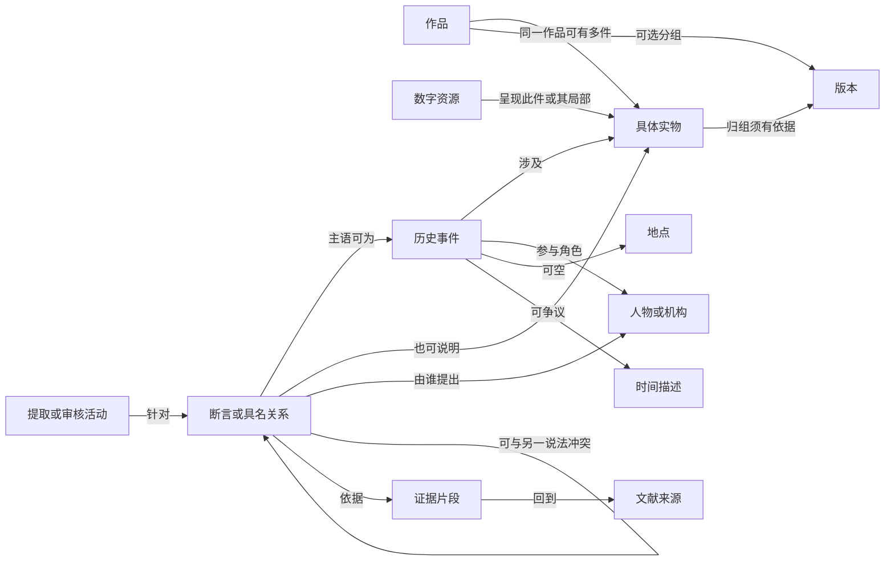

# 碑帖之间的领域本体与数据架构研究

**审议稿 · 2026-11-24 · 仓库基线 `c6fd7c0`。** 本体是一套约定，让编辑和 Agent 对“同一部作品”“同一件实物”“某人曾这样判断”等说法有一致的理解。建议保留现有作品、实物和来源编号，优先补上**某条说法由谁提出、具体写在哪里**。一卷《祭侄文稿》就足以检验这项选择：两跋可以同出一卷、同出一人，仍给出两个不同年份。

本报告的“现状”取自指定提交；“提议”供负责人审查；“试例”是独立 JSON，可单独删除。书目事实以原刊或机构记录为准，样例中的“馆方记载”指可在页面定位的文字。实际核看纸本、鉴定真伪、独立编辑批准均须另外记录。[现行证据流程](../atlas-workflow.md) · [字段定义](../../src/domain/types.ts) · [五件试例 JSON](ontology-pilot.json)

## 一、相关研究怎样改变字段设计

| 研究及查阅深度 | 实体、元数据、关系与证据的启发 | 对本项目的取舍 |
| --- | --- | --- |
| 仇开域、夏翠娟《碑帖知识库构建：从智慧化加工到智慧化服务》，《图书馆论坛》2024 年第 6 期，99–109 页。本次核对正式卷期和公开摘要，未取得全文 | 从整部文献进一步揭示文本、图像、流藏和单字，服务于查阅、循证研究和欣赏。摘要不足以复原作者全部字段、事件类及审核规则。 | 字形观察应能返回具体拓本；细部字段依据下列可读全文另行设计。[卷期记录](https://ncpssd.org/journal/details?gch=90009A&num=6&years=2024) · [作者摘要](https://www.dhcn.cn/information_technology/library_information_and_digital_libraries/7191.html) |
| Qiu、Xia、Liu，*Development of ancient Chinese inscription rubbings knowledge base…*，重点核读 §6.2、§6.4 | 上海图书馆将作品、版本、单件和注释分层。单字图记录来源拓本和图中位置；注释保存内容、来源与撰者，可容纳不同解释。 | 版本可作为有据分组；单件、说法和图像仍各有身份。这与上一篇属于同一机构的实践证据。[论文原文](https://doi.org/10.1108/DTS-02-2024-0016) |
| Liu、Bian、Song、Shen、Lai，*Knowledge Organization Initiative for Digital Resources of Ancient Chinese Stele Inscriptions*，2023，机构库摘要 | 先从成熟碑刻元数据归纳领域本体，再建立关联数据，强调与存量相容。本次可核到方法与目标，未核到作者完整类表、事件属性或逐条引用机制。 | 先拿已有档案验证问题，再决定扩展；下文词表由本项目提出。[伊利诺伊大学机构库](https://www.ideals.illinois.edu/items/131142) |
| 李永卉等《碑刻资源语义化组织研究》，《数字图书馆论坛》2021 年第 12 期，重点核读 §2.4 图 2 与焦山案例 | 以碑刻连接材质、字体、碑文、书写者、镌刻者、时间、藏地和相关文献，通过标识符关联资源，用 IIIF 看图。作者信息以期刊书目为准。 | 人物要附角色，出土地与藏地应分别表达。关系再附出处，才能从检索线索走到可复查的论证。[期刊条目及全文入口](https://journals.istic.ac.cn/dlf/ch/reader/view_abstract.aspx?file_no=202112008) |
| 胡佳佳、彭炜明、柯永红《历代碑刻数字化研究平台的构建》，核读第二节图 1–3 | 以拓片、释文、切分字形为可互查的对象，保留著录书、分册、页、行列及字形与释文的对应关系。重点是文字检索，逐事件的证据审核不属于这一设计的主要任务。 | 先允许“碑面＋字词＋出处”的文字定位。图权和画布落实以后才加像素区域；同字出现两次须分开定位。[作者正文](https://achieve.dhcn.cn/site/works/dhjournal/202103/15039.html) |

国际模型解决不同层次的问题。CIDOC CRM 用事件把实物、参与人、地点和时间连起来；Linked Art 给出馆藏数据的实用表达，尤其区分制作、保管与所有权。CRMinf 关心判断和推理，PROV-O 关心一份数据是由谁、怎样产生。IIIF 描述数字图像的呈现、顺序、区域与标注。这些层次可分别借鉴。一个人曾持有实物、一个人今天转录该说法，是相隔数百年的两项活动。[CRM 7.1.3](https://cidoc-crm.org/html/cidoc_crm_v7.1.3.html) · [Linked Art 递藏](https://linked.art/model/provenance/) · [CRMinf 1.2.1](https://cidoc-crm.org/extensions/crminf/html/CRMinf_v1.2.1.html) · [PROV-O](https://www.w3.org/TR/prov-o/) · [IIIF Presentation 3](https://iiif.io/api/presentation/3.0/)

CBDB 的人物关联有关系类型、另一方与来源，可帮助消歧；CHGIS 将地名、行政单位的名称与有效时期、引据联系起来。外部编号宜作带依据的比对结果，不能凭同名绑定，也不能用县级时段记录给某次交接生成精确坐标。Noy 与 McGuinness 建议先定范围、列出要回答的问题，再复用术语、设计类及属性并用实例迭代。下面每个新结构都对应一个可验收的问题。[CBDB 数据结构](https://cbdb.hsites.harvard.edu/structure-cbdb) · [CHGIS 数据设计](https://chgis.fas.harvard.edu/pages/database/) · [Ontology Development 101](https://protege.stanford.edu/publications/ontology_development/ontology101.pdf)

## 二、仓库审计（现状）

| 资料及规模 | 已能表达 | 缺口及影响 |
| --- | --- | --- |
| 85 条作品，其中 49 条草稿 | 稳定 ID、中英题名、别称、碑帖分类、朝代、创作日期、书体、署名角色及出处、背景、审核与双语注记 | 署名是姓名文字，人物文章另有编号。同名和传称要人工辨认；作品层证据难精确定位到某句话。[作品](../../data/works) |
| 95 件实物，其中 58 件草稿 | 33 原碑、21 墨迹、19 拓本、7 摩崖、6 翻刻、5 摹本、4 残片；登记制作期、馆号、尺寸、存佚；共有 7 条有方向的实物关系 | 同一作品下的多件实物已有稳定身份；版本分组、装册组成与同件实物不同字口观察没有独立结构。[实物](../../data/objects) |
| 95 个馆藏断言、69 条实物事件、33 个地点 | 本批馆藏分为 85 条机构著录、10 条原址；类型另支持“最后所知”“未知”。事件含所属实物、类型、时间、原地名、地点引用、摘要、确定性和来源；29 个地点无坐标 | 机构常以地点表达；持有者常写在摘要。一次迁移、交接、后人记述的日期须分别判断。专题地图另有参照地标，不能导成事件发生地。[地点](../../data/places.json) · [专题地标](../../data/yan-qinli-journey.json) |
| 141 条文献、1 条实物媒体 | 网页和纸本可带定位；媒体绑定实物，并含来源、署名、许可及权利依据 | 单条书目 locator 很难区分同页两跋；裁图和母图、权利与考证证据有不同用途。[来源](../../data/sources.json) · [媒体](../../data/media.json) |
| 作者 Markdown 含 4 篇作品、3 篇书家、2 篇读帖；另有 1 条具名人物关系 | 文章元数据关联作品、实物、人物和来源；人物关系有方向、文字、类型、来源和审核状态 | 人物条目数不能代表档案提及的人数。关系的审核状态也不能替代对史实的确定程度。[文章类型](../../src/domain/knowledge-types.ts) · [人物关系](../../data/knowledge-relations.json) |

现有数据检查覆盖编号、引用、日期、坐标基准、双语对齐、证据和媒体权利；正式构建还检查审核状态。浏览器与命令行分别导入数据，目录生成器另外生成供 GitHub 阅读的副本。研究设计若获准，三处都须做兼容检验。仓库外部权威库、推理引擎、站内多人编辑和 IIIF 服务均属于候选方向。[校验器](../../src/domain/validate.ts) · [发布门槛](../../scripts/lib/release-gate.ts) · [生成目录](../../scripts/lib/catalogue.ts) · [既有工程计划](../engineering-plan.md)

## 三、能力问题与五件试验

能力问题（Competency Questions）就是让读者用真实材料向模型提问。表中为试验的预期答案。JSON 内的记录引用本仓库既有对象，阅读每一行时可沿“断言 → 出处编号 → 段落或题跋”查回去。

| 问题 | 试验与可接受答案 | 反例或边界 |
| --- | --- | --- |
| Q1 同一作品有哪些实物？Q2 能确定拓自哪一方石头、何年拓制吗？ | 《颜勤礼碑》有原石和故宫新00045406。馆方记“民国拓本”，试例只给时代。查馆号能返回这一件。 | 关联到同一作品不足以新建“拓自”边。不能把原石 1922 年出土写入这本的经历。[故宫拓本条目](https://www.dpm.org.cn/collection/impres/234175.html) · [原石事件及其出处](../../data/objects/yan-qinli-original-stele.json) |
| Q3 某传本的称名、实际摹者和图像各是什么？ | 《兰亭序》以神龙本作可检索称名，关联神龙本实物与其开场裁图。项元汴题记的归名与馆方对归名的质疑分开查。定武兰亭另有实物号。 | 不连出“定武直接拓自神龙本”，也不把图片制作者当成书家。神龙本藏品直开超时，归名段通过该馆页面检索正文核对，另有馆方出版说明旁证。[神龙本条目](https://www.dpm.org.cn/collection/handwriting/228279.html) · [故宫出版说明](https://www.dpm.org.cn/journal_detail/239217.html) · [定武兰亭](https://www.dpm.org.cn/collection/impres/233468.html) |
| Q4 哪件拓本留下什么字口？Q5 谁提出了关于书者的判断？ | 《礼器碑》新00044512 的条目描述“绝思”字口；同页另引翁方纲关于七人书写的观点，分别指向拓本、石刻。 | 不从该说法生成七名确定书家。馆方文字可定位，尚无本试例可复核的像素区域。[故宫《明拓东汉礼器碑》](https://www.dpm.org.cn/collection/impres/234635.html) |
| Q6 哪一件被剪裱成册，怎样定位其版本特征？ | 《张猛龙碑》新00045763 著录为明拓、剪裱成册共 36 页，并以“盖魏”两字的状态辨本。36 页和字口均落到该册。 | 原石与另一部拓本均不继承册页数。单凭同名、时代或此条评价，不给别册排先后。[故宫《明拓北魏张猛龙碑》](https://www.dpm.org.cn/collection/impres/228416.html) |
| Q7 两条记载是否针对同一事件？Q8 能否选定交接年和地点？ | 《祭侄文稿》同一得卷事件，鲜于枢拖尾楷书跋记壬午，行书跋记癸未。分别返回 1282、1283 和两处定位，首选值留空。 | 两说不等于事件持续两年。“东郓曹彦礼”也不足以定位交接。原记录的争议时间范围供旧界面兼容使用。[台北故宫题跋释文](https://digitalarchive.npm.gov.tw/Collection/Detail/3?dep=P) · [原事件](../../data/objects/witness-jizhi.json) |
| Q9 谁在何时提取这些说法，谁批准？Q10 哪些图可以复用？ | 本试例共同提取者为 Codex，研究稿待审；说法的原作者逐条记录。查数字资源须回到该件媒体的权利记录。 | 网站可看、史料有出处、图片可再发布、编辑已批准是四种独立判断。[试例元数据](ontology-pilot.json) · [媒体权利字段](../../data/media.json) |

## 四、概念模型、数据字典与受控词表（提议）

图中一条关系若本身涉及考证，须落实为可引用的一条断言。版本表示据著录或特征划出的组，同一实物在不同研究者的版本划分中可有不同归属。证据是“这份文献的这一处”；断言是“某人在那里对某件东西作出的具体判断”。由此，同一处证据可支撑多条断言，同一页亦可容纳相互冲突的证据。



下表中“1”“0–1”“0–多”“1–多”表示每条记录可有多少个值。编号采用稳定字符串；所有 `Ref` 必须指向相应类别。这里是建议的逻辑字典，试例采用精简 JSON，对未试用的扩展保留文字规范。

| 对象 | 字段、类型与数量 | 录入与辨认规则 |
| --- | --- | --- |
| Work 作品 | id、题名各 1；别名、署名断言 0–多；创作时间描述 1 | 沿用现有作品号。碑或帖是临习分类；同作的晚期拓本单记制作期。 |
| Version 版本 | id、work、label、basis 各 1；归组断言 1–多 | 写明依据是命名、字口、版式或有据谱系。仅有“明拓”可直接记制作时代。允许并存分法。 |
| Object 实物 | 旧 id、workId、载体类型、制作时间描述各 1；馆号 0–1；有向实物关系 0–多 | 一件有独立馆号的册或卷保持一个身份。局部、题跋或单字用定位描述；独立编目再考虑新号。 |
| DigitalResource 数字资源 | id、objectId、文件或网址、署名、权利依据各 1；母图、画布、区域各 0–1 | 图的裁切、拍摄与原作的书写分别记录。区域仅在确知画布、尺寸、授权时引用。 |
| Actor 人物、机构 | 本地 id、类型、首选名各 1；别名、外部号比对 0–多 | 角色随活动变化。机构可迁址，所在地用有时段的关系。身份未消歧时保留原姓名文字。 |
| Place 地点、Time 时间 | 地点 id 与名称各 1；有时间效力的地名 0–多；坐标 0–1。日期有 kind、certainty；原文、上下界可缺 | 日期可只知年号或约年。两个互斥年份挂两条断言；区间用于持续期或上下界。坐标另记基准、精度和出处。 |
| Event 事件 | id、事件类型、所属实物各 1；时间、地点、参与者角色、证据分别记录，参与者 0–多 | 区分发生、题跋追记、现代著录。保管变化与所有权取得分别选择；只知“经某人手”不补买卖。 |
| Claim 断言或关系 | id、subject、predicate、value、kind、voice 各 1；evidence 1–多；冲突组 0–多 | value 按谓词限定为编号、整数或原文。voice 表示说法的提出者或转述来源；实际录入者另记。 |
| Evidence 与 Source | 每个证据项有 source、locator 各 1，短引文 0–1；来源含出版者、题名、网址或书目 | 机构网页用段名、题跋书体、署款或馆号定位；纸书用版本、卷页。引述前人时注明转引链。 |
| Extraction / Review | 提取活动有操作者、方法、日期及输入；审查有对象、决定人、日期、理由和状态 | 样例共有的制作者、方法、状态在顶层声明。只有负责人授权的编辑决定可形成审核记录；资料核对日期不代替古物查验日。 |

**受控词表。** 受控词是各编辑共用、含义固定的写法。下列为最小集合；旧枚举完整拼写以类型文件为准。新增词须附定义、适用对象、正反例和替代旧词的办法。

| 维度 | 使用词与方向 |
| --- | --- |
| 旧分类与状态 | 保留全部七类实物及既有 `rubbing-of / recarving-of / fragment-of`（衍生件 → 源件）；`collection-institution / in-situ / last-known / unknown` 描述馆藏；`draft / reviewed` 描述审核。 |
| 时间与把握度 | 继承 `single / range / approximate / era / unknown` 和 `documented / approximate / disputed / unknown`。文献明确写有某说和该说已有定论分别判断。 |
| 试例谓词与值域 | `production-era` 为时代文字；`assigned-version` 为同作品版本号；`copyist-attribution` 为未消歧的归属说法；`diagnostic-reading` 为具体实物字口；`writer-count` 保留观点原意；`album-leaf-count` 保留馆方计量用语“页”；`event-year` 为非零整数，主语必须是事件。 |
| 说法与操作 | `source-report` 来源记载；`scholarly-opinion` 署名观点；`editor-interpretation` 编辑解释。机器抽取记在活动层 `agent-assisted-extraction`。审核通过表示可按该归属发表；直接观察还需观察者、对象及观察记录，不把转录标成实物目验。 |
| 候选扩展 | 事件角色按需设书写人、刻工、旧藏者、新保管者、记述者；版本关系可提议“摹自”“同一字口状态”，各自要求底本或状态证据。允许标明证据反对某项归属；相似、同名、共现均不能自动推得身份或师承。 |

归属争议另用可选字段 `stance` 标记立场。`supports` 是所引材料支持该归名，`questions` 是材料对该归名提出质疑；不填时仅陈述所引内容。《兰亭序》两条记录的对象、谓词和值完全相同，声音、立场和定位不同。因此按“冯承素”检索时，两种意见都能找到。质疑者没有因此提出另一个摹者。

### 完整性约束与试验方法

1. 每条断言有唯一编号、可解析的主语、合法谓词、匹配类型的值、可辨认的说话者和至少一条可定位的证据。馆方转述前人时，分别记说话者和文献发布者。未附证据的 AI 候选进入待查清单，不进入事实检索。
2. 实物号只属于一件实物；馆号按机构限定。实物关系禁止自指；有方向的物质派生关系不得成环。把一件实物归入版本，版本与实物须属于同一作品，且断言可追溯。分组不自动推出两件实物的底本关系。
3. 实物事件回指本件；当事件地点没有佐证时，保留原地名或空值。持有者、机构、地名和地图点分开核对。来源访问日、事件日期、查验日和编辑批准日不能互相填充。
4. 冲突组有至少两条不同断言，须能逐一复原证据。若给出首选结论，应另存有理由的编辑决定和日期；旧断言始终可读。争议值不能由平均、排序或最高模型评分自动决定。
5. 文字定位和图像定位独立。区域坐标须落在对应画布边界内；无权利依据时可保留馆方页面链接。没有区位资料不得制造矩形框。权利声明对应具体数字文件。
6. 试例顶层状态是待审。自动校验通过、提取有署名、原资料标为已审核，三者均不自动提升新增断言。已存在的原文、中英文对齐数组、空值、未知说明和 ID 在兼容投影中逐项比对。

**如何重做五件试验。** 在仓库根目录运行以下只读查询，可以看到同一事件的两个年份、两处跋文定位和空的首选值。JSON 中的 `guard` 是给审阅人的反例，`unresolved` 是现阶段不能回答的问题；二者都不作为历史断言。此试验验证字段能表达答案，不测搜索系统的召回率，也不能证明五件以外的资料都能无损转换。

```sh
node -e "const p=require('./docs/research/ontology-pilot.json');const c=p.cases.find(x=>x.work==='jizhi');console.table(c.claims.map(x=>({year:x.value,locator:x.evidence[0].locator})));console.log(c.conflicts)"
```

## 五、国际标准映射

本次逐项核验结果为 5 个作品号、9 个实物号、10 条断言、10 处证据定位。已检查实物归属、事件所属实物、引用来源、样例版本及媒体指向，并核对《祭侄文稿》冲突组的两个取值、不同定位和空首选值。关系图已用 Mermaid 渲染。以上是研究稿自检；资料库原有校验器不会检查这份研究 JSON。

下表的“直接”指语义足够接近、可作为导出目标；“条件”指先满足表中的证据条件；“本地”指保留领域字段或由多个标准实体组合。这里比较概念，尚未制作符合 Linked Art API 的 JSON-LD（带标准词义的网址化 JSON）。

| 项目概念 | CIDOC CRM 候选类或关系 | Linked Art 的表达及边界 | 等级 |
| --- | --- | --- | --- |
| 一件纸本、独立石碑 | E22 Human-Made Object；E12 Production 经 P108 指向制成品 | HumanMadeObject 的 produced_by；原址摩崖若区分天然岩体与人工刻痕，应考虑 E25 Human-Made Feature | 直接／摩崖有条件 |
| 一部作品、文本与字形 | E33 Linguistic Object 对应文字，E36 Visual Item 对应视觉内容，E65 Creation 对应创作 | LinguisticObject、VisualItem 可各自标识，由载体 carries 或 shows。作品总目保留本地号，不能把全文、笔迹、石头合为一个标准实体 | 条件 |
| 神龙本等版本组、字口 | E55 Type 可作受控分类；具体辨认行为可依 E13 Attribute Assignment | classified_as 可表达分类。归组理由、字口状态及传摹谱系需本地断言；只有著录确把某物列入版本才建立成员边 | 本地 |
| 拓制、翻刻、残片 | 有据的制作可用 E12，经 P16 指向所用特定底本；现存部件可考虑 P46 is composed of | produced_by 表达过程；“拓自”“翻刻自”仍保留工艺语义；历史残片关系不直接导为当前部件 | 条件 |
| 人、机构、地、时段 | E21 Person、E74 Group、E53 Place、E52 Time-Span；活动经 P14、P7、P4 关联参与者、地点、时间 | Person、Group、Place、TimeSpan；区分机构与馆址、原地名与现代对应。CBDB 与 CHGIS 编号需人工对齐才附入 | 直接／身份匹配有条件 |
| 迁移、交接、权属 | E9 Move；E10 Transfer of Custody；E8 Acquisition 需所有权变更证据 | Move、TransferOfCustody、Acquisition 可分别记录；馆方今日著录只支持馆藏断言，不能反推一次取得所有权的事件 | 条件 |
| 学术判断、引文、相反解释 | E13 表达赋值活动；E31 Document 可标识文献。CRMinf I4 Proposition Set 对应命题内容，I2 Belief 对应对命题的态度，I5 Inference Making 对应从前提得结论 | AttributeAssignment 可表达某人作出的属性判断，文献及定位可作为引用。完整冲突组、支持或反对理由和复核记录保存在本地 | 条件／本地 |
| 图像、册页顺序、局部 | 信息与载体分别描述；数字文件可与 E36 视觉内容相连 | DigitalObject 通过 digitally_shows 连接视觉内容。IIIF Manifest 管理呈现，Canvas 作页面或视图的坐标面，Annotation 将内容或评论连至目标。Image API 提取区域；授权另核 | 条件 |
| 机器提取与编辑审核 | PROV-O Entity 是输入或产出，Activity 是提取或审核，Agent 是人、机构或软件；used 和 wasGeneratedBy 可追溯操作 | 可保留本地记录或另导 PROV-O。审核是编辑活动，推理是否可靠还要检查所引史料；资料版本变更须能回查原输入 | 本地＋PROV-O |

核对标准定义时，优先看类的适用范围及关系的起点、终点。比如只知道一件拓本换了保管人，CRM E10 已足够；新增 E8 会额外声称产权转移，需要另一层证据。[CIDOC CRM 类与属性](https://cidoc-crm.org/html/cidoc_crm_v7.1.3.html) · [Linked Art 实物](https://linked.art/model/object/) · [递藏](https://linked.art/model/provenance/) · [数字内容](https://linked.art/model/digital/) · [CRMinf](https://cidoc-crm.org/extensions/crminf/html/CRMinf_v1.2.1.html) · [PROV-O](https://www.w3.org/TR/prov-o/) · [IIIF 图像规范](https://iiif.io/api/image/3.0/)

## 六、设计取舍与渐进迁移（均待负责人决定）

| 决策及学术依据 | 备选的收益与代价 | 建议与复议条件 |
| --- | --- | --- |
| 是否给每件实物设版本层。上图案例分 Work、Instance、Item，试例同时含独件与有称名的传本。 | 全部强制建版可统一层次，却会制造大量只有名字的空版本；仅存实物简单，却无法讨论两种分组意见。 | 默认保留 workId；有目录称名、可比较字口或谱系问题时才建版本，归组另附证据。第二件相似拓本加入时验证成员规则。 |
| 怎样保存异说。CRMinf 区分命题和判断，《祭侄文稿》给出同页异跋的实证。 | 把异说写入注记便于阅读，机器难分别查询；完全套用推理本体，录入成本高。 | 先为争议、归属和关键关系保存最小断言与定位。确实要比较多步论证时，再补前提和信念活动。 |
| 是否把机构、人物、地名全部对齐。CBDB、CHGIS 和 CRM 给出身份与时空分离的依据。 | 自动按名合并省工，错误会扩散；全部先建权威档案，则普通编辑负担过重。 | 有歧义或跨档案查询需要时建立本地号，写明候选外部号、时段和比对依据。先允许只录原称。 |
| 图像标注怎样起步。字形研究与 IIIF 都强调回到原图位置。 | 全量切字适合字形统计，图权、定位和复核成本高；整图链接成本低但难定位。 | 从文字定位到已有授权画布，再到区域。一件授权图的回查任务通过后再讨论批量处理。 |
| 文件还是图数据库。自下而上的碑刻研究强调兼容；PROV-O 可供交换而不限定存储。 | 图数据库适合大量多跳查询，需额外服务、备份及维护；文件易审查，但遍历、连接和去重可能变慢。 | 先做只读索引或导出。只有明确的多跳问题在目标数据量上未达到约定耗时，且有人负责运行成本，再做数据库对照试验。 |

**迁移工作量按证据区分。** 复用 85 个作品号、95 个实物号、已有文献与实物事件 ID 属机械映射，可批量核对。抽取现有 7 条实物关系、为来源补逐条定位属中等工作量，须人工检查原段落。逐一辨认署名人物、从叙事拆出机构交接、判别版本、确认字口图权属高成本；五件样例不足以推算全库人日。某件文献未能打开时保留待查状态和原始文字。

| 阶段与启动条件 | 输入、验收和退出 |
| --- | --- |
| 0 · 本次研究 | 只提交本报告、试例和文档入口。负责人可接受研究、要求修订或暂缓实施。合并研究稿只保留研究成果。 |
| 1 · 获单独授权后，做五件并行试点 | 旧 JSON 仍为权威源，新增研究层只引用旧 ID。编辑逐条从十个问题查回出处，特别复核冲突年份、传称与字口。记录每件耗时、需专业判断的字段和无法定位的条数；可移除研究层回退。 |
| 2 · 五件试点经人工接受后扩大抽样 | 加入摩崖、残片、失传或未知地点、无图权、机构迁址等反例。对比旧版与只读投影的 ID、排序、深链接、来源、双语文本、审核、空值和地图点；生成目录与网页同看。不能还原的字段另列损失清单。任一记录误升审核、丢异说、丢来源或生成假坐标即停止切换。 |
| 3 · 有实际需求才切换或导出 | 指定每个字段唯一编辑源，按版本构建旧格式投影；记录引用旧编号的跳转映射、备份提交和回退演练。用正式出版门槛验收生产版本。机构间交换可先导少量 Linked Art/PROV-O；上线写入服务、图数据库或 IIIF 服务分别立项。 |

**给协作 Agent 的交付口径。** 先报作品号和实物号，再交“一条说法、一个可复查位置、一个不确定点”。分清谁写下材料、谁提出解释、谁提取记录、谁有权接受。遇到相反材料，新增断言并连到原问题；保留旧说，提交负责人决定如何展示。实施方案与学术审核分别留在各自的 PR。[现行协作与证据规则](../atlas-workflow.md)
